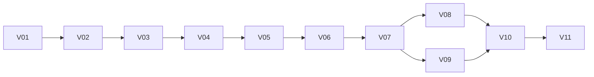

# 02 – Verarbeitung (Upload -> Ergebnis): Index

Status: **HOTSPOT**. Hier steht und fällt alles – die Qualität der Verarbeitung entscheidet über den Nutzen des ganzen Produkts.
Stand: 15.11.2026 – 04_beantworten zum Ort mit Blättern aufgespalten (D38–D42). Davor: 13.11.2026 – aus einer Datei in fünf Teildateien aufgespalten (Inhalt unverändert übernommen); V10 um fehlenden geprüften Bescheid ergänzt.

Andockpunkte: Ast 2 "Akt aufbauen" und Ast 3 "Pflichten ableiten" in [[D07]]. Fachliche Grundlage für V06–V11: [[D04]]. Datenobjekt Key-Info: [[D46]].

**V-Kennungen sind Nodes, keine Reihenfolge.** Jede Kennung bezeichnet einen Node und bleibt fest. Die tatsächliche Kette steht **nur** in der Übersicht unten. Neue Nodes bekommen die nächste freie Nummer, es wird nie umnummeriert.

## Übersicht der Kette (tatsächliche Reihenfolge)
| Kennung | Node | Status | Datei |
|---|---|---|---|
| V01 | Upload | beschrieben | [[D23]] |
| V02 | Speichern | grob | [[D23]] |
| V03 | Auslesen und Einstufen | beschrieben (MVP-Ansatz; Änderung vorgemerkt) | [[D23]] |
| V04 | Gruppierung (Seiten -> Dokumente) | beschrieben (MVP-Ansatz) | [[D23]] |
| V05 | Duplikate auf Dokumentebene | offen | [[D23]] |
| V06 | Abschnitte erkennen | grob | [[D24]] |
| V07 | Dokumenttyp bestimmen | grob | [[D24]] |
| V08 | Auflagen extrahieren (parallel je Dokument) | grob | [[D25]] |
| V09 | Informationen aus Prüfdokumenten extrahieren (parallel je Dokument) | grob | [[D25]] |
| V10 | Bestätigungen den Auflagen zuordnen (Matching, Code) | grob | [[D38]] |
| V11 | Offene Auflagen mit sonstigen Dokumenten abgleichen (agentisch) | beschrieben (grob) | [[D39]] |

Diagramm des Beantwortungsalgorithmus (V10 -> V11): vereinbart, noch nicht erstellt ([[D26]]).

## Teildateien
| Kennung | Datei | Inhalt | Status |
|---|---|---|---|
| [[D23]] | 01_einlesen | V01–V05, Einstufung der Inhalte | in Arbeit |
| [[D24]] | 02_klassifizieren | V06–V07 | grob |
| [[D25]] | 03_extrahieren | V08–V09 | grob |
| [[D26]] | 04_beantworten/ | V10–V11, Subauflagen, fehlender Bescheid (Ort: [[D38]] Matching, [[D39]] agentischer Abgleich) | HOTSPOT |
| [[D27]] | 05_querschnitt | Umfang, Einstiegspunkte und Ungültigkeit, Fehlerbehandlung, PDF-Sonderfälle, Verhalten, Recherche | in Arbeit |

## Stopp / Weiter
- Weiter: Diagramm V10 -> V11 in [[D26]].
- Stopp: Prototyp-Vergleich und LangChain erst, wenn das Gesamtbild ausgereift ist ([[D19]]).

## Noch nicht besprochen
- Wahl der KI-Modelle, Kosten pro Akt ([[D14]])
- Prototyp läuft auf LangChain – ob das die richtige Grundlage ist, wird später geprüft ([[D19]])
