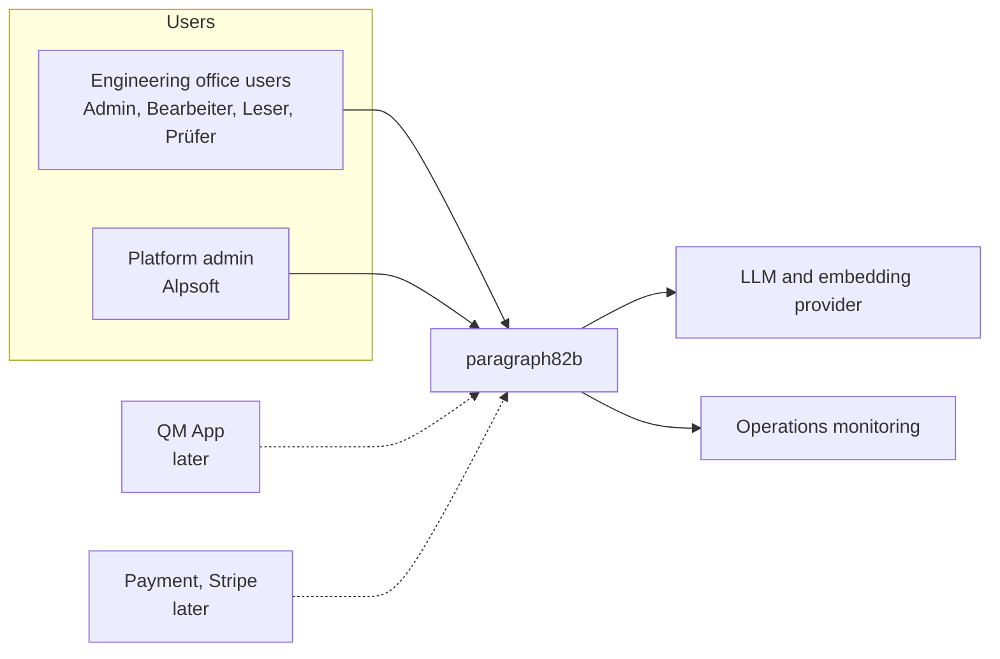
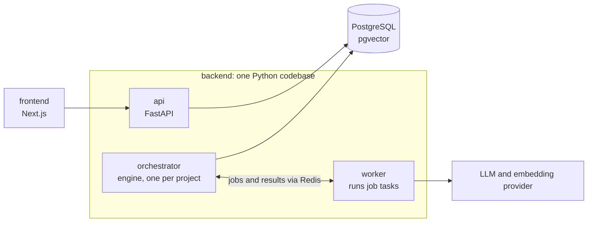
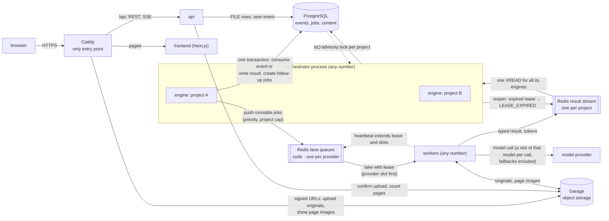
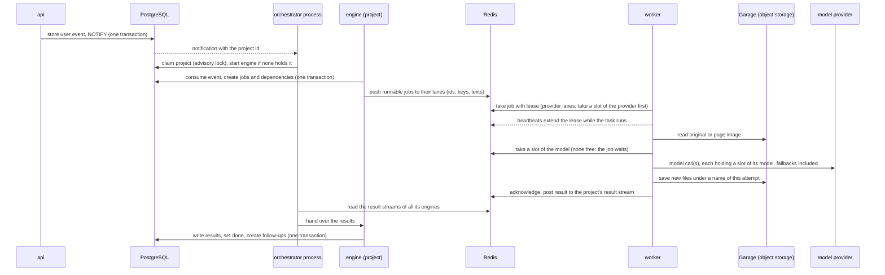
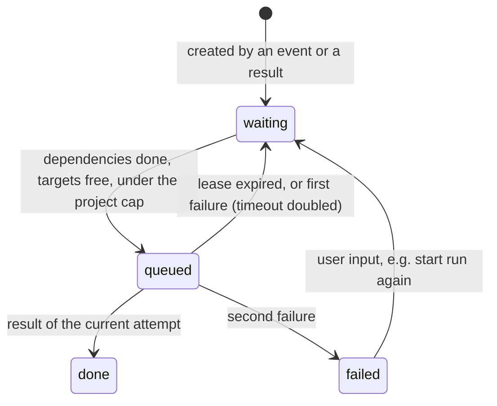
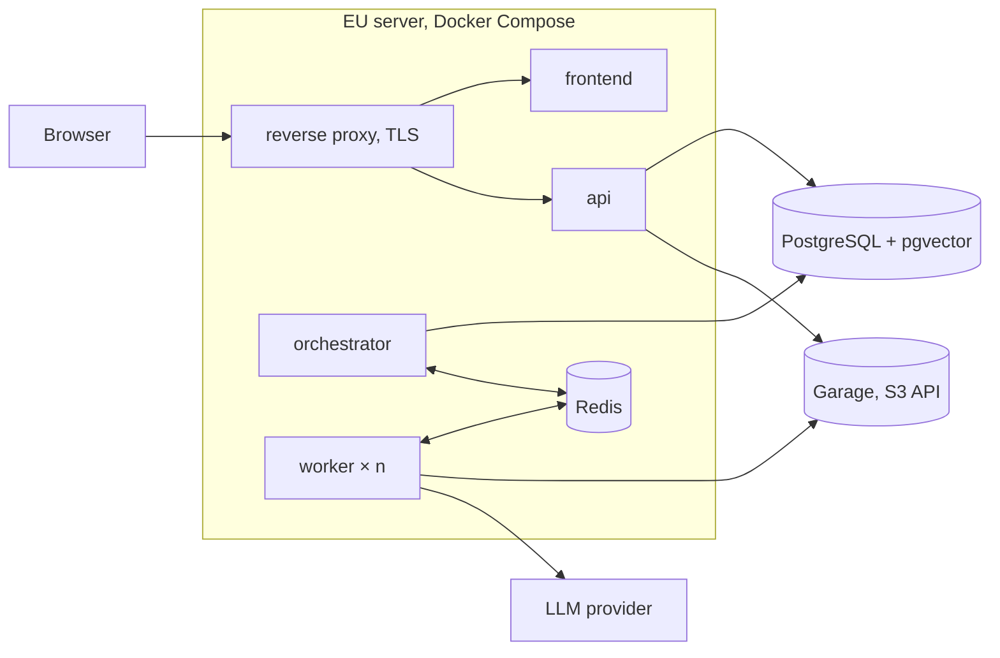

# paragraph82b — Software Architecture

Status: **draft** · Version 36 · 2026-11-25 · Task T-3

Final result only: this file always shows the current architecture. How it got here (versions, decisions,
reasons) is in `Architecture.html`, published as an artifact: https://claude.ai/artifact/W6NpC843bDsLgYiUH15Ljj. Data structures are in [`Data_Model.md`](Data_Model.md); the concept in `infos/`
(referenced by its IDs, e.g. D17, V04).

Markers: **Decided** (name, date) · **Suggestion** (not decided) · **Open** (see [Open decisions](#open-decisions)).

## 1. Scope

- **MVP, platform-wide** (Andreas, 2026-11-18): everything the MVP contains (concept D17) — project and onboarding,
  building the Akt (upload, processing, editor), deriving obligations, inspection (comments, walkthrough checklist,
  risk classification), measures, report with approval and versions, basic roles, tenant separation,
  confidentiality.
- **Prepared, not built** (D17 "Architektur trotzdem vorbereiten für"): tenant types, plans and feature flags,
  project access and transfer, generic inspection duties with interval, interfaces (QM App), iterative processing.
- **Out of scope:** mobile/offline, recurring checks and monitoring, QM App interface, plan analysis, architect and
  authority access, other rulebooks (D17, D18).
- Processing is described in the most depth: it decides the value of the product (D15).
- **Order of work** (Andreas, 2026-11-18): **project processing first, as a self-contained unit** that works on
  its own and is integrated into the platform afterwards. Login, roles, feature flags, reports and rulebooks are
  decided later.
  - The processing unit covers the modules akt, processing, ai, knowledge (up to key info extraction, as the data
    model) and notes, plus what they need to run and to be seen: a minimal api and frontend, PostgreSQL, Redis,
    Garage (object storage), orchestrator and workers.
  - **Integration seam:** the unit gets the current user and the project from a small identity interface. Until A8,
    a stub returns one development user with access to every project; no login. Row Level Security and the
    encryption wrappers are already called through this seam, so integration replaces the stub, not the callers.
- **Proof of concept first** (Andreas, 2026-11-18): before any platform stack, a proof of concept shows that projects
  run through the event-driven job pool and that the results are good enough (measured against the golden dataset).
  The data pipeline is the core business and is independent of who may use it.
  - In the proof of concept: engine, job pool, workers and the job types up to key info extraction, with PostgreSQL
    and Redis; files on the local disk behind a small file interface; started from the command line on a folder.
  - Not in the proof of concept: api, frontend, login and access, encryption, object storage product, deployment.
  - **Order** (Andreas, 2026-11-18): (1) the whole job pool architecture as intended (engine, events, lanes,
    sorted queues, semaphores, leases, cap, result streams, restart); (2) the job functions one after another, each
    measured against the golden dataset; (3) frontend and user flow, also to look at the data; (4) permissions and
    encryption patched in afterwards.
  - So that (4) stays a patch: every file read and write goes through the one file interface; content columns are
    read and written only through the owning module's interface; every content row carries project_id.
  - **Object storage and encryption are Thomas's decisions** (Andreas, 2026-11-18). Object storage is decided
    (Garage, section 8); section 9 holds the current proposal for encryption until he decides.

## 2. Quality goals

Taken from the concept; they drive the decisions below.

| Goal | Meaning | Source |
|---|---|---|
| Confidentiality | Business secrets and open defects; platform admins see no customer content by default; every access logged; later encryption per tenant | D06, D14 |
| Fault tolerance | Single pages may fail; processing never aborts, never crashes | A05, D02, D27 |
| Transparency | Every automatic decision is logged, visible and reversible; source chain requirement → page → document | D02 |
| Iterative, non-blocking | Upload more at any time; only new or affected parts are processed; users correct while processing runs | D02, D27 |
| Scale and cost | From ~15 to more than 5,000 pages per Akt; cost per page matters | D27 |
| EU and GDPR | EU hosting, backups, GDPR | D14 |
| Extensibility | Tenant types, plans, rulebooks (Pfade) and interfaces plug in without rewiring the core | D06, D11, D13, D17 |

## 3. Context



- First users: engineering offices, concretely SiBP (D17).
- Payment points towards Stripe (D14); not part of the MVP list (D17) — **Open** whether needed in the MVP.

## 4. Building blocks

**Decided** (Andreas, 2026-11-18, A1; ADR-paragraph-82b-0004): **modular monolith.** One Python codebase
(FastAPI) with strictly separated modules, run as three processes from the same code; the Next.js frontend is
separate.



| Process | Does | Scales by |
|---|---|---|
| api | HTTP API for the frontend: reads, user actions (stored as events), uploads | requests |
| orchestrator | Consumes events per project, schedules jobs, writes job results in batches (section 5) | number of active projects |
| worker | Runs job tasks; no database access; returns typed results | LLM load (pages per minute) |

Why: the rule "consuming an event and its effects is one transaction" needs one database and one codebase; a small
team keeps one deploy; the heavy LLM load still scales on its own through the worker process.

**Modules** (one package each; a module uses another only through its public interface; checked by import rules
in CI):

| Module | Holds | Concept |
|---|---|---|
| identity | tenants, users, roles, project access, feature flags | D43, D06 |
| projects | project (Betriebsobjekt), master data, onboarding | D03, D07 branch 1 |
| akt | files, pages, documents, sections, reference numbers, editor actions | D44, D04, V01–V07 |
| processing | engine (events, scheduling, batch writer) and job type definitions | D15, D27 |
| knowledge | key infos, requirements, evidence, claims, matching, status calculation | D46, D47, V08–V11 |
| notes | notes for the user and the event log | D02 |
| inspection | comments, walkthrough checklist, defects, risk classification | D07 branch 4, D49 |
| measures | measure plan | D07 branch 5, D49 |
| reports | report snapshots, versions, PDF output, office branding | D07 branch 6, D49 |
| rulebooks | Pfade as configuration (e.g. § 82b interval, catalogue) | D11 |
| backoffice | platform admin: plans, support access, feature flags | D06, D14 |
| ai | AI flows (LangChain/LangGraph) per job type, model configuration, token usage capture | D14, D15 |
| integration | external API (prepared, not built in the MVP) | D13 |
| billing | plans and payment (prepared, not built in the MVP) | D14, D16 |

**Job types are split by role** (Andreas, 2026-11-18). Example `ocr_page`:

```
processing/
  engine/            generic: events, scheduling, lanes, batch writer
  jobs/
    ocr_page.py      chain part: precondition, inputs, follow-up candidates, what it invalidates
ai/
  flows/
    ocr_page.py      LangGraph flow, returns the typed result
  model config       model per job type (section 6); its provider decides the lane
akt/
  service            apply_ocr_result(...): writes text, features, classification
```

- The whole chain (preconditions, follow-ups, invalidation) is readable in `processing/jobs`; it changes often while
  the steps after key info extraction are still open.
- AI flows and their model configuration are gathered in `ai`, so a job type's model can be switched in one place
  (section 6).
- Each module writes only its own data, through its public interface; the engine calls it inside the batch
  transaction. Job types without a model call have no flow in `ai`.

### Where it is in the code

The source submodule carries no references to this repository (rule 3 in `AGENTS.md`); this table links its code to
the sections, decisions and concept IDs here (Andreas, 2026-11-23). Paths are relative to
`the-real-and-final-paragraph82b/`.

| Code | Sections, decisions, concept |
|---|---|
| `backend/app/platform/files.py` | sections 1 and 9 (one file interface, encryption seam), section 8 (Garage), section 7 (signed URLs) |
| `backend/app/modules/projects/` | section 7 (tiers limit a project), data model (TIER) |
| `backend/app/platform/logging.py` | section 10 |
| `backend/app/modules/identity/` | section 1 (stub user until login), A8 |
| `backend/app/modules/akt/` | data model (files, pages, documents, sections, reference numbers) |
| `backend/app/modules/akt/pages.py` | V01 (accepted formats), section 7 (upload limits per file) |
| `config/garage.toml`, `docker-compose.yaml` | section 8 (Garage) |
| `backend/app/modules/notes/events.py` | section 5 (user events wake the orchestrator) |
| `backend/app/modules/processing/jobs/` | section 4 (job type split by role) |
| `backend/app/modules/processing/models.py` | data model (job tables) |
| `backend/app/modules/processing/engine/` | section 5 (engine, orchestrator, worker runtime, failures) |
| `backend/app/modules/processing/pool/` | section 5 "Job pool, lanes and fairness" (lanes, semaphores, result streams), ADR-paragraph-82b-0007 |
| `backend/app/pipeline/ingest.py` | data model (job types: ingest_file) |
| `backend/app/pipeline/ocr.py` | data model (job types: ocr_page), V03 |
| `backend/app/modules/ai/` | section 6 (models, providers, fallbacks), A3, A4; `flows/ocr_page.py`: V03, D04 (document kinds), prompt from the prototype |
| `backend/app/pipeline/runs.py` | data model (user actions: start_run), section 7 (page limit of the tier) |
| `backend/app/api/` | section 7, A9 and A9c (upload path), V01 (rejections reported together); permissions in T-4 step 4 |
| `frontend/lib/api.ts` | section 7 (hand-written types until generated from OpenAPI) |

## 5. Processing runtime

Decided so far (data model, section "Architecture, not ER model", and versions v22–v31):

- **Event-driven job pool, not a pipeline** (Andreas, 2026-11-17; ADR-paragraph-82b-0003). Any stage can be reset by
  invalidating its jobs.
- **Reset to before a job type** (Andreas, 2026-11-23): a development tool, not a user action; allowed only with
  `stage_reset: true` in `config/<environment>.yaml` (local and dev, never prod). Reset points are job types, in the
  chain order of the registry: resetting to before one undoes it and every later one (e.g. before `ocr_page`; grouping
  is reset before `decide_border`, its first job type, not as a separate "before grouping"). Each job type that can be
  reset knows how to undo its results. The engine consumes the reset as a user event, so it stays the only writer of
  its project: results and jobs are deleted in one transaction, waiting jobs leave their lanes, a result still
  arriving for a deleted job is ignored. Start run then queues the stages again. Turned page images stay in the store
  until unreferenced files are cleaned up.
- **One engine per project** (first called an orchestrator per project, renamed in A5 below); projects never
  reference each other (Andreas, 2026-11-17).
- **Events** are stored in a table and consumed by the project's orchestrator in order. Consuming an event and its
  effects (new jobs, dependencies, stale marks) is one transaction; open events are processed again after a restart
  (Andreas, 2026-11-17, v28). The engine keeps an in-memory view of the project state.
- **Engine and job type definitions** (Andreas, 2026-11-17): to keep the orchestrator from becoming a god object,
  a generic engine (event intake, scheduling with the concurrency check, batch writer) plus one definition per job
  type: precondition, inputs, task, how its result is written, what it invalidates, follow-up candidates.
- **Follow-ups are candidates:** the engine checks each candidate's precondition and starts it only when it holds
  (e.g. a border needs every page of its window read) (Andreas, 2026-11-17).
- **Concurrency rule:** a job starts only when none of its write targets is used by a running job and none of its
  read targets is being written (JOB_TARGET read/write).
- **Jobs do not touch the database.** A job's task returns its own typed result; the orchestrator collects results
  and writes them in batches (Andreas, 2026-11-17). Finishing a job (write results, set done, create follow-up
  jobs) is one transaction (v28).
- **Two sources of jobs** (Andreas, 2026-11-18): an engine consumes a user event (sets `processed_at`; the event
  stays as history) or writes a job result; in both cases the trigger, its effects and the new jobs are one
  transaction, so a crash never leaves half a state.
- **EVENT holds user actions and events that mean something to the user** (e.g. document built, note raised), not
  "job done": the JOB row already says that, and follow-ups come straight from the result (Andreas, 2026-11-18).
- **Failures** (Andreas, 2026-11-17, v23): a temporary failure is retried at once with a higher timeout; if that
  fails, it is lasting — job failed, a note on the failed object, new jobs only after user input. A failure never
  blocks other jobs; jobs that depend on missing or invalid data do not start.
- **Restart** (v28): jobs that were in the pool go back to queued (attempt + 1); a job whose lease expired is
  treated the same. Token usage of a crashed attempt may be lost.
- **Consistency check** (v29): from time to time (e.g. when a project is idle) waiting jobs must still wait for
  something and jobs in the pool must be in Redis; findings go to monitoring.
- **User changes** are collected and processed on "Apply changes", like "Start run" (Andreas, 2026-11-17).
- **Job types** up to key info extraction: see `Data_Model.md`, "Job types".

### Runtime (A5)

**Decided** (Andreas, 2026-11-18, A5; ADR-paragraph-82b-0007):

- **Many projects per orchestrator process.** An `orchestrator` process hosts one engine per active project (an
  asyncio task). A project is claimed exclusively through a PostgreSQL lock, so several orchestrator processes can
  share the projects and one takes over after another crashed. Idle projects are unloaded.
- **Names** (Andreas, 2026-11-18): the **engine** is the logic of one project; the **orchestrator** is the process
  that hosts many engines and knows no project logic.
- **The orchestrator process** (Andreas, 2026-11-18) only does operations:
  1. **wakes engines:** PostgreSQL reports each new user event at once (`LISTEN/NOTIFY`); if no engine holds the
     project, the process claims it and starts its engine; a check every few seconds catches missed reports;
  2. **unloads engines** of projects with nothing to do: no unconsumed event, no job in the pool, no waiting job
     that could run now. Jobs that wait for user input (e.g. after a failure) do not keep an engine alive;
  3. **reaps expired leases** and hands them to the project's engine (attempt + 1);
  4. **reads the result streams** of its engines in one Redis call (a shortcut only).
- **Distributed:** orchestrator processes and workers run on any servers; they need the same PostgreSQL and Redis,
  workers also the file store. The project lock is a PostgreSQL advisory lock bound to the process's connection,
  so it is released when the process or its connection dies. An engine that loses its connection or lock stops at
  once. Each process takes at most a configured number of engines, so load spreads without a central scheduler.
- **Redis as message channel.** The engine puts runnable jobs with their inputs into Redis lane queues; workers take
  them, send heartbeats and post typed results to the project's result stream. A job taken but not
  acknowledged by a dead worker goes back to queued (restart rule above). Details below.
- **Large inputs through object storage.** A job message holds ids, texts and object-storage keys. The worker reads
  images straight from object storage and saves new files there (e.g. a turned page), returning the key in its
  result. Workers never touch the database.

### How the parts are linked

Solid arrows carry work, dashed arrows only wake or report. Caddy is the only entry point; the browser reaches
Garage only through short-lived signed URLs. PostgreSQL is the source of truth; Redis holds only messages in transit.



One job from user action to written result:



A job's status in the database; "running" exists only in Redis:



- Redis holds only messages in transit; PostgreSQL stays the source of truth (jobs, events, results). After a Redis
  loss the engine re-sends queued jobs from the database.

### Job pool, lanes and fairness

**Decided** (Andreas, 2026-11-18):

| Place | Holds | Purpose |
|---|---|---|
| JOB table (PostgreSQL) | all jobs of all projects, status waiting, queued, done or failed, with project_id and priority | source of truth, restart, progress |
| lane queues (Redis) | only runnable jobs of all projects, one sorted queue per lane | what workers take from |
| result streams (Redis) | one per project (`results:<project_id>`) | results back to the project's engine |

- **One shared pool.** Workers belong to no project and no orchestrator; they take whatever runnable job comes next,
  so they work where most is needed. A job message carries project_id and job type; the worker posts its result to
  the project's result stream. When another orchestrator process takes the project over, its engine reads the same
  stream on, so no result is lost (Andreas, 2026-11-18).
- **Running is known in Redis only** (Andreas, 2026-11-18): the engine does not see when a worker takes a job, and
  workers do not write to the database. A job in a lane's in-flight set is running; the result carries
  `started_at`, `worker_id` and the duration, written with the result. No heartbeat writes to the database.
- **Lost lease** (Andreas, 2026-11-18): a live worker that reaches Redis always keeps its lease; the heartbeat runs
  apart from the work (heavy work in a thread), so it is never blocked. A worker that cannot extend its lease stops
  that job and sends no result. The engine accepts only results of the job's current attempt. Each attempt writes its
  files under its own name (e.g. `pages/<page>/<job>-<attempt>.png`); files nothing points to are removed by a
  clean-up when the project is idle.
- **Lanes per provider** (Andreas, 2026-11-23; replaces lanes per model): each provider of a configured model
  (section 6) has its own lane, since providers limit the requests; job types without a model call share the lane
  `code`. Switching a job type's model to one of another provider moves its jobs to that provider's lane. Note:
  OpenAI states its rate limits per model; two models of one provider now share one limit.
- **Sorted queue per lane** (Redis sorted set). The rank is priority first, then time. Jobs from "Apply changes" get
  the fast lane priority and come before waiting jobs of other projects; more priority levels are possible.
- **Semaphore per provider, taken before the job.** A worker goes through the lanes; for a provider lane it first
  takes a slot of that provider's semaphore (size in configuration) and only then takes the first job of the lane. No free slot:
  it skips the lane. No job: it gives the slot back.
  - Slots are leases with an expiry, extended by the worker's heartbeat; a dead worker's slot frees itself.
- **Limit per model, taken per call** (Andreas, 2026-11-25): besides the provider slot, every model call holds a slot
  of the model it calls (`max_parallel` of the model, else `default_max_parallel`), a fallback's call a slot of the
  fallback model, so a model's limit counts all its calls. A model without a free slot is not called: the job waits
  and is tried again later, like a rate limit. The slots are leases on the same Redis semaphore (own keys per model),
  kept by a heartbeat for the length of the call; a slot lost during the call (Redis unreachable longer than the
  lease) is taken back once, and if all are in use by then, the call finishes over the limit and this is logged.
  Redis failing never fails the call: no slot can be taken means the job waits; a slot that cannot be given back
  frees itself when its lease runs out.
- **Taking a job is a lease too.** Taking moves the job atomically from the queue to the lane's in-flight set with an
  expiry; the worker's heartbeat extends it; acknowledging the result removes it. An expired lease (dead worker) puts
  the job back as queued (restart rule). Sorted sets do not bring this, so it is built into the queue code.
- **Cap per project.** An engine keeps at most N of its jobs in the pool at once, over all lanes (queued plus
  running; N in configuration). It holds back the rest and adds more as results arrive, so a 5,000-page Akt cannot
  crowd out a small project.
- **Rate-limit answers** (HTTP 429): the job goes back into its lane with a short, growing delay (rank in the
  future); this counts as no attempt and does not raise the timeout.
- Limits on tokens per minute are not covered; a token bucket can be added later on the same principle.
- Workers serve all lanes in the MVP; a worker can be limited to some lanes by configuration (e.g. own OCR workers).

| Mechanism | Solves |
|---|---|
| lanes with a semaphore per provider | provider rate limits and load; a bottleneck stays in its lane |
| sorted queue with priority | fast lane for corrections |
| cap per project | fairness between projects |

## 6. AI models and flows

**Decided** (Andreas, 2026-11-18, A3 and A4; ADR-paragraph-82b-0006):

- **Modular per job type.** Each job type that calls a model names its model in configuration (provider, model,
  parameters). A job type's model can be switched on its own, when another model fits that step better; nothing else
  changes.
- **Start:** all job types use the OpenAI API with one API key (environment variable, never in the repository).
- **Configuration** (Andreas, 2026-11-23): in `config/<environment>.yaml`. `providers` names each provider, its kind
  (`openai`; `openai_compatible` for a local server, which is planned) and the secret holding its key; `models`
  names each model's provider, its `fallbacks` and optionally `max_parallel`; `job_models` names the model of each job type (`ocr_page`:
  `gpt-5-mini`). Choosing a model chooses its provider and lane.
- **Fallback when a model is unavailable** (Andreas, 2026-11-23): each model has an ordered list of fallback models
  (empty for now). On no connection, timeout, server error (5xx, including 503 overload) or model not found, the same
  call goes to the next model in the list; when all fail, the job waits and is tried again later, not counted as
  failed. The result and its token usage name the model that produced it. A rate limit (429) is not a fallback case:
  the job waits and the same model is tried again. A fallback call holds a slot of the fallback model (section 5),
  but no slot in its provider's lane when that is another provider (accepted for now).
- **Open:** fallback when a model's result is too weak (stage 2); further mechanisms for rate limits.
- **Real data** (Andreas, 2026-11-23): quality runs on the golden dataset may send real pages to the OpenAI API from
  the local machine; prod stays blocked until the terms are checked (below).
- **AI flows with LangChain and LangGraph.** A job's task runs its flow (a LangChain call or a LangGraph graph) inside
  the worker and returns the job's typed result; flows never touch the database (section 5).
- **Allowed providers** (A3): providers with processing in the EU and storage of the content excluded by contract,
  US or European. **Open:** check the OpenAI account's terms (data retention, region) before real customer data is
  processed in prod.
- **Token usage** is recorded per call (model, input, reasoning, output) and returned with the job result; the
  orchestrator writes TOKEN_USAGE (data model).

| Job type (up to key info extraction) | Model use |
|---|---|
| ocr_page | vision model: classify page, read text, page features |
| embed_page, embed_keyinfo | embedding model |
| find_sections, classify_document, extract_keyinfos | text model |
| ingest_file, decide_border, assemble_document, duplicate checks, check_reference_numbers | no model (code), unless decided otherwise per job type |

- **ocr_page flow can be replaced** (Andreas, 2026-11-18): for now one vision flow. The job type's inputs and result
  stay fixed, so the flow inside can change later without touching the orchestrator, e.g. a classic OCR pipeline
  first and a vision agent only when it fails or its result is insufficient (e.g. handwriting).
- **Reuse from the prototype** (Andreas, 2026-11-18): job logic (e.g. OCR) is taken from `paragraph-82b-prototype`
  and reworked to fit this architecture; only the functionality is taken, integrated where it fits. Prompts that work
  are kept as they are.

Consequences and guidelines:
- **Embeddings:** the vector size is fixed per column; changing the embedding model means re-embedding every page and
  key info of a project. Store the embedding model name with the vectors. **Suggestion**, to confirm in the data
  model.
- **LangGraph state:** nodes return only the fields they change. Returning the whole state with an adding reducer
  counts token usage several times (seen in the prototype).
- Quality and cost per job type are compared on test data before a model is switched (A13).

## 7. Frontend and API

**Optical reference** (Andreas, 2026-11-18): the shared Claude mockup "paragraph82b MVP Stufe 4" (minimal version;
https://claude.ai/artifact/QjvAQ6coECAhNYDWzpDuH8). A fuller version exists ("paragraph82b Mein Betrieb", prototype
v1); it is not the reference now. For the processing unit two of its pages matter:

| Page | Shows |
|---|---|
| Unterlagen hochladen | page quota of the tier (used of available, storage used, warnings near or over the limit; a photo counts one page, a PDF its pages); drop zone for several photos or PDFs at once (incl. HEIC) with upload progress; table "Ihre Uploads": upload, kind and files, pages, uploaded at, status "bereit zur Verarbeitung" |
| Verarbeitung und Ablage | notice "Neue Unterlagen bereit" with "Verarbeitung starten" (a run starts only on this button, matching "Start run"); progress "Verarbeitung läuft …"; figures (pages, documents, Bescheide, Auflagen, plans, Prüfbefunde), last run finished at and duration; "Dokumente nach Ablage", read-only, grouped by document kind, each with title, date, issuer, source upload, marks "neu" and "nur Information" |

Notes from the mockup, for later: it is made for the package "Mein Betrieb" (single businesses), while the concept's
MVP starts with engineering offices (D17); HEIC is not listed in V01 and would be converted on ingest.

**Decided** (Andreas, 2026-11-18, A9):
- **REST with OpenAPI.** FastAPI describes every endpoint in OpenAPI; the frontend uses a TypeScript client generated
  from it, so types stay in sync. User actions are POST requests that store events (e.g. "Verarbeitung starten" →
  start_run, data model "User actions on the job pool").
- **Live progress with Server-Sent Events.** The browser opens one event stream per open project; the api pushes
  progress (e.g. pages read, documents built, key infos found, from the JOB table) whenever the orchestrator reports
  a change through Redis. One direction is enough for progress.
- **Progress shown per stage, plus remaining time** (Andreas, 2026-11-18): exact counts where the total is known
  (files, pages for OCR, embeddings and borders, documents found so far for their evaluation), growing counts where
  it is not (documents found, key infos found); no single percentage. Remaining time ≈ open pages × seconds per page
  (per job type, from quality runs) ÷ parallel workers, shown once measured values exist. Counts come from JOB
  (done, queued, waiting) and Redis (running).
- **Uploads straight to object storage** (A9c; Andreas, 2026-11-18, left the choice to the recommendation; built
  2026-11-23, T-8):
  1. the frontend asks the api for upload slots (file names, sizes, types); the api checks access, allowed formats,
     the size per file and the storage of the project's tier, adds a pending FILE per accepted file (in the order
     chosen, which is the upload order) and returns a short-lived signed upload URL per file. Files are taken in order
     while the storage lasts; the rest is rejected, so the order is never broken;
  2. the browser uploads straight to Garage under `projects/<project>/files/…`, a few files at once, with progress.
     The signed URL accepts exactly the declared size and type (Garage refuses anything else, checked 2026-11-23);
     the bucket's CORS rule admits only the frontend's origin (set by the api on start);
  3. the frontend confirms each file; the api compares the stored size with the declared one, reads the file, counts
     its pages (a photo one page, a PDF its pages), stores the content hash and sets it ready ("bereit zur
     Verarbeitung"). Unsupported or unreadable files are rejected with one collected notice per upload (V01) and
     deleted from Garage. Only ready files are processed.
  - One signed PUT per file; multipart only when files get larger than one request handles well.
  - Pending uploads count against the storage from the moment their URL is handed out, so unconfirmed uploads
    cannot exceed it.
  - **Interrupted uploads** (Andreas, 2026-11-23, T-10): the browser sends the files itself, so leaving the page
    stops an upload; the page asks first. Dropping the same files again continues: files of the same name and size
    already in the project are skipped ("schon vorhanden"), pending ones continue in their own FILE with a new
    signed URL. A pending upload not done `upload.abandon_after_seconds` after it began (YAML, at least the signed
    URL validity) is abandoned: shown as such, no longer counted against the storage, and removed with whatever
    reached Garage on the next upload to the project. **Open:** the order of continued files (today they move to
    the end; the order is in the file names for now) and the cleanup of other unreferenced files.
  - Page images are shown the same way: the api redirects to a short-lived signed URL.
  - The api is never blocked by large files.
  - Exception to the wrapper rule (section 9): the browser writes the original upload around the file store wrapper.
    Once encryption is built, `ingest_file` rewrites the original through the wrapper (read, encrypt, replace) before
    anything else reads it; until then nothing changes, since the wrappers pass data through.
- **Upload limits per file** (Andreas, 2026-11-23; in `config/<environment>.yaml`, the same for every tier, since
  they protect the system): at most 200 MB per file, 2,000 pages per PDF, 100 megapixels per photo. Rejected files
  get their own reason (V01). Pages above 50 megapixels are rendered smaller, not rejected (A4 at 150 DPI is about 2
  megapixels, A0 about 35). Pages are rendered and stored one at a time; parsing, hashing, rendering and file writes
  run apart from the event loop. The earlier limits per upload request (2 GB, 500 files) are gone with the upload
  through the api.
- **Tiers limit a project** (Andreas, 2026-11-23): every project has a tier (table TIER, data model), edited in the
  database because the values will change. A tier holds the planned pages, a margin (10 %), and the storage for
  uploads. Starting values: Basis 150, Pro 500, Enterprise 1000 planned pages; storage = page limit × 10 MB × 2
  (about 3.3, 11 and 22 GB), enough for twice the pages as large photos, small enough that nobody can store
  unlimited amounts. New projects get the default tier (Basis, a placeholder until plans are settled).
  - The margin is a silent grace (Andreas, 2026-11-23): users see only the planned pages (e.g. 500); 503 pages are
    simply read, so nobody is tempted to aim for the margin. The api never sends the margin or the page limit;
    pages over the tier are reported as yes/no, without a count that would reveal it. After a run the counts of
    read pages show it anyway.
  - Upload: allowed up to the storage; everything uploaded is kept.
  - `ingest_file` splits every file, since it costs no model calls and the page count is shown.
  - `ocr_page` reads only the first *planned pages + margin* pages in upload order (e.g. 550 for 500). A page's
    place counts the pages of all earlier files, ingested or not, so it does not change when files are ingested
    out of order. Pages beyond stay stored, unread.
  - From grouping on, only pages up to the last document border within the limit go further; a document that
    crosses the limit does not go on at all, its read pages are kept (no half document in the pipeline). Built with
    `decide_border`; the only borders known before are file starts.
  - A larger tier lets the next "Verarbeitung starten" read and process the rest.
  - The pricing model itself (projects priced by maximum page count, D19; plan names, D16) is Thomas's to settle.
- **For now, in the proof of concept** (2026-11-18, T-4): the status stream checks the database once a second instead of
  waiting for a report from the orchestrator; the TypeScript types are written by hand; no login, every request
  acts as a development user. The frontend has the two pages above, with the pages of a project shown in place of
  "Dokumente nach Ablage" until documents are built.

## 8. Data and storage

- PostgreSQL with pgvector (Andreas, 2026-11-17, same stack as the prototype); embeddings per page and per key info
  (data model v15, v16).
- Files and page images live in S3-compatible object storage; workers read and write there directly (A5).
- **Decided** (Thomas and Andreas, 2026-11-23, A6): **Garage**, self-run in every environment. Code speaks only the
  S3 API; replication and backups are our job. Chosen over SeaweedFS (paid edition holds self-healing, repair and
  single sign-on; more parts to run: master, volume servers, filer with its own store, S3 gateway) and MinIO
  (community Docker images no longer published, checked 2026-11-18). Garage supports the presigned URLs the upload
  path needs; multipart uploads are stricter than Amazon's in some edge cases.
  - **Built only when needed** (Thomas and Andreas, 2026-11-23), then **built** for uploads straight from the browser
    (Andreas, 2026-11-23, T-8): Garage v2.5.0 in Docker Compose, one node with `replication_factor = 1` locally;
    bucket and access key are created on first start from the values in `.env`. The file interface (`FileStore`)
    has an S3 implementation; the local-disk one remains for tests.
  - **Suggestion** (not decided): admin viewer `khairul169/garage-webui` (cluster, buckets, keys, object browser),
    reached only locally or through an SSH tunnel, never public, since it holds the admin token and shows
    confidential files. Any S3 client can browse the files as well.
- **Decided** (Andreas, 2026-11-18, A7): key layout `projects/<project>/files/…`, `projects/<project>/pages/…`.
  Projects are shared and transferred between tenants (D05, D10), so the prefix is the project, not a tenant;
  deleting a project deletes its prefix. Garage has no bucket policies: rights are granted per access key and
  bucket, not per prefix; the api checks project access before it hands out a signed URL (section 9).
- **Open:** retention of files after a project is deleted; backup schedule (with A2).
- **Tenant separation** (Andreas, 2026-11-18, A7): **shared schema, the project is the unit of separation.**
  - All tenants share the same tables. Content rows hang on project_id; Row Level Security lets a request see only
    rows of projects its tenant or user has access to (PROJECT_ACCESS).
  - Tenant-owned data (users, plans, branding, settings) carries tenant_id and is filtered by it.
  - Revoking or transferring access changes PROJECT_ACCESS only; no data moves (D06, D10).
  - The data model leaves tenants out of its current scope; TENANT and the project's link to tenants are added there
    later.

## 9. Security and confidentiality

Principles from D06 (platform admins see no customer content, time-limited support access with customer consent,
every access logged and visible to the customer, real loss of access after revocation, later encryption per
tenant).

### Encryption seam

**Open, Thomas decides** (Andreas, 2026-11-18); not part of the proof of concept. Proposal so far: **plain text
during development, behind empty wrappers.** All content passes
through wrappers that will handle encryption later; today they pass data through unchanged.

| Wrapper | Wraps | Today | Later (per-project keys) |
|---|---|---|---|
| file store | every read and write of files and page images (api and workers) | passes bytes through | encrypts and decrypts with the project's data key |
| field cipher | content columns marked as confidential in the data model | passes values through | encrypts and decrypts those columns |
| key provider | data keys per project | returns no key | gets the project's data key, unwrapped with the key of a tenant that has access (envelope encryption) |

- No code reads or writes content around the wrappers; this keeps encryption a later change in one place.
- Every call carries the project (and the requesting tenant), so a later implementation knows which key to use.
- **Later key scheme** (Andreas, 2026-11-18, A7): one data key per project, wrapped once for every tenant with
  access; revoking access deletes that tenant's wrapping. Fits shared and transferred projects.
- Limits for later: encrypted columns cannot be searched in PostgreSQL; embeddings stay unencrypted for vector
  search; workers need the keys; the model provider always sees plain text. Which columns get the field cipher is
  decided with the data model.

### Access and infrastructure

**Decided** (Andreas, 2026-11-18):
- TLS for every connection (browser, PostgreSQL, Garage, model provider); disk encryption (LUKS) on dev and prod
  servers; backups encrypted with a key kept apart from the servers.
- Users: permission check in the app (tenant type × plan × role × project access, D06, A8); PostgreSQL Row Level
  Security as a second net per tenant (the app sets the tenant per transaction).
- Own database and Garage credentials per process with least rights (api, orchestrator; workers no database).
- Files in the browser only through short-lived signed URLs; revoking project access works at once in the app.
- Support access only with a stored, time-limited grant by the tenant admin; every content access logged and
  visible to the customer.

**Open** (A8): authentication and roles in detail.

## 10. Observability

- Two separate stores (Andreas, 2026-11-17): EVENT table = project history for users and the orchestrator's input;
  a log/metrics store for the operator across projects (job durations, failure rates, retries, queue length, worker
  heartbeats, token usage over time). Matches D14 ("Logging / Ereignisprotokoll" and "Systemmonitoring").
- Monitoring holds only ids, counts and durations, no customer content (D06).
- **Minimal now, Grafana stack later** (Andreas, 2026-11-18, A12):
  - Now: api, orchestrator and workers write **structured JSON logs to stdout** (ids, project, job type, lane,
    duration, status, attempt, tokens; no content). A small internal status page reads the JOB and TOKEN_USAGE tables:
    queue length per lane, running and failed jobs, cost per project and job type.
  - Later on dev and prod: self-hosted Grafana with Prometheus (metrics) and Loki (logs), fed through OpenTelemetry;
    the log fields stay the same, so no code changes. Self-hosted, in line with A2.
- **LLM tracing with self-hosted Langfuse, local only** (Andreas, 2026-11-18, A12): shows each flow step, prompt,
  answer and tokens for debugging. Traces contain document content, so Langfuse runs only locally (e.g. with the
  golden dataset), never on dev or prod for now. No LangSmith: it is hosted by a US company and would send
  confidential content out (A2, AGENTS.md rule 6).

## 11. Testing and quality

**Decided** (Andreas, 2026-11-18, A13):

### Golden dataset
- One golden dataset from a single representative project: **documents and their classification are complete;
  key infos are representative** (a sample, not all of them).
- **Stored outside Git**, on a shared Alpsoft drive (a subdirectory of the mount); found through an environment
  variable with its path. Neither the main repository nor the source submodule holds real data (AGENTS.md rule 6,
  ADR-paragraph-82b-0005). The drive is fine for this data (Andreas, 2026-11-18).
- Layout (Andreas, 2026-11-18; dataset still being completed):
  - Inputs as they would be uploaded: PDFs (several pages) or images (one page each), as in the data model.
  - **Group folder = document type** (e.g. Bescheide, Verhandlungsschriften, other authority documents, emails);
    **subfolder = one document**. Grouping and classification are therefore labelled by the folder structure.
  - **Key infos** are labelled in YAML files per document (e.g. requirements of a Bescheid), each with a type.
  - Folders not yet sorted, and output of earlier prototype runs, are not part of the golden dataset.
  - Parts are usable already for OCR, grouping and classification (Bescheide, Verhandlungsschriften, other authority
    documents, emails); key infos follow.
  - The exact format of the label files follows when the dataset is ready.
- **No separate loader** (Andreas, 2026-11-18): one shared pytest fixture (`conftest.py`) is the only code that knows
  the layout. It reads the path from the environment variable (tests are skipped, not failed, when it is missing, so
  the default run works without the drive, e.g. in CI) and returns plain objects: documents (type from the group
  folder, files and pages from the subfolder) and key infos (from the YAML, with type). Tests and quality runs both
  use it; quality runs feed the files through the same path as an upload (`ingest_file`), so the real processing is
  measured, not a test-only path.
  - Environment variable with the path: `P82B_GOLDEN_DATASET_DIR` (Andreas, 2026-11-18).
- **Raw input and expected result** (Andreas, 2026-11-23): `P82B_INPUT_DATASET_DIR` holds the raw input files as a
  user would upload them; quality runs feed these through the upload path, and the application changes only its own
  copies in the file store. `P82B_GOLDEN_DATASET_DIR` holds the expected result to compare against. **Neither
  folder is ever written to** by the application or the tests; both paths are machine-local, in `.env`. The drive
  does not enforce this yet (the folders are writable for the local user).
- **Building it up** (Andreas, 2026-11-23): first run on the raw input, then Andreas reviews the results and reports
  findings in the terminal; corrections become tests first (below). The golden dataset grows from what he confirms.

### What is measured, stage by stage

| Stage | In the golden dataset | Measured |
|---|---|---|
| pages → documents (borders, V04) | complete | borders right, documents matched exactly, too many joined or split |
| document type (V07) | complete | right per type, confusions (e.g. Bescheid taken for Verhandlungsschrift) |
| key infos (V08, V09) | representative | recall on the marked key infos; key infos found beyond them go to a list for review, not counted as wrong |

- **Each stage is measured with the golden inputs of the stage before** (e.g. document type on the golden documents,
  not on our own grouping), so an error is seen where it arises, not only where it shows. The job pool makes this
  easy: every job gets its inputs and returns a result.
- Each quality run also reports cost and time per page, per job type and model (basis for switching models, A3).

### From error to test to fix
1. A quality run finds an error.
2. It goes into the **error catalogue** (`docs/Error_Catalogue.md`, to be created): error class, stage, case id in the
   golden dataset, cause; no document content.
3. A test that produces the error is written first (red); the fix is developed until it passes without breaking
   other tests; the test stays as a regression test.

| Kind of error | Example | Test |
|---|---|---|
| in code, deterministic | border rules, contradicting page numbers, matching by Geschäftszahl | unit test on the features of the pages concerned; runs always; in the repository with made-up text showing the same pattern |
| in the model (prompt, model choice) | requirement missed, wrong document type | eval case run live against the model several times (answers vary), passing when e.g. 3 of 3 runs are right; uses the golden dataset, runs locally only |

### Test levels

| Level | What | Data |
|---|---|---|
| job tests | each job as a pure function: input in, result out | made-up example pages |
| engine tests | preconditions, invalidation, restart, lanes, cap per project, with fake workers | no model |
| integration | whole flow with PostgreSQL, Redis and Garage in Docker Compose | made-up mini Akt |
| quality runs and eval cases | stage metrics and error cases | golden dataset, local only |

- **Recorded model answers** (Andreas, 2026-11-18, where possible and not too costly): automated tests replay
  recorded model answers (on made-up data); live model calls only in eval cases and quality runs. Where recording
  costs more than it saves (e.g. a flow still changing every day), that test calls the model live and is kept out
  of the default test run.

## 12. Deployment and environments

**Decided** (Andreas, 2026-11-18, A2; ADR-paragraph-82b-0005): **containers on rented servers of a European
provider**, run with Docker Compose, as in the prototype. No US cloud provider holds customer data.

| Environment | Purpose | Who works there |
|---|---|---|
| local | development and tests; the only place agents work | developers, agents |
| dev | live test version | people only |
| prod | customers | people only |



- Every environment runs the same images. **Configuration** (Andreas, 2026-11-23): only secrets in `.env` (never
  committed) or environment variables; all other settings in `config/<environment>.yaml` in the repository, one file
  per environment (`local`, `dev`, later `prod`), chosen by `P82B_ENV`. An environment variable overrides a YAML
  value (e.g. for one test run or a container). The database URL is built from the YAML and the password; the
  backend refuses to start when a secret is in the YAML or a setting is in `.env`.
  - **Exception: values of one host** (Andreas, 2026-11-23, T-9) go into that host's `.env` too, named `P82B_*`:
    the environment, addresses that differ per host, the containers of the host (number of workers, image) and the
    dataset paths. Host names stay out of the shared repository. The YAML names such a value as a variable
    (`${P82B_DATABASE_HOST}`); a missing one stops only a process that uses that setting.
  - **Addresses per part** (Andreas, 2026-11-23): PostgreSQL, Redis, the api, Garage (for the processes and for the
    browser) and the frontend (CORS origin) each have their own address in the YAML, so each can move to a host of
    its own.
- **Containers and roles** (Andreas, 2026-11-23, T-9): one backend image runs the api, orchestrator and worker; the
  command picks the process. Docker Compose starts a host's roles by profile: `core` (migrations, api,
  orchestrator, next to PostgreSQL, Redis and Garage) and `worker`. A host with only workers needs only the worker
  Compose file and no database settings. The app containers use the host's network.
- **dev environment** (Andreas, 2026-11-23, T-9): one core host on the office network runs the roles `core` and
  `worker`; further hosts add workers. Hosts reach each other over the office network (no separate private network);
  services that other hosts use listen on the core host's network address, Redis with a password. The api listens
  only on the core host itself; users reach the app through Caddy (see "Entry point"), a developer's own frontend
  through an SSH tunnel.
- **Deploy to dev** (Andreas, 2026-11-23, T-9): every push to the deploy branch (for now `andreas`, later `dev`;
  Andreas, 2026-11-23) is deployed by self-hosted GitHub Actions
  runners on the hosts (the hosts are not reachable from GitHub): the core host first (build, migrations, start),
  then the worker hosts from the same commit. Each host builds the image itself, natively for its processor; no
  registry yet. Each host keeps its `.env` outside the checkout. Registering a runner needs admin rights on the
  repository.
- Workers scale by running more `worker` containers (by hand in the MVP).
- Backups of the database and the object storage are our job (no managed service assumed).
- **Entry point** (Andreas, 2026-11-23, T-11): **Caddy** as the core host's only entry point, a container in the
  `core` role: HTTPS, only addresses of private networks (office, VPN), `/api` to the api, the bucket's signed URLs
  to Garage, everything else to the frontend, which runs as a production build in the same role. api and frontend
  listen only on the core host itself. The address users open is a value of the host (`P82B_PUBLIC_HOST`).
  - **No login in dev until A8** (Andreas, 2026-11-23): everyone who reaches the address on the office network
    sees the projects.
  - **Certificates:** Caddy's own certificate authority until a real certificate is set up. Alpsoft's public apps
    use Let's Encrypt; for a host not reachable from the internet that needs the DNS challenge (API token of the
    DNS provider, Caddy with its plugin). **Open:** DNS provider and token; DNS entry for the address.
- **Suggestion** (from the prototype, to confirm): images in the GitHub container registry once several hosts
  should pull one image; build and deploy to prod with GitHub Actions.
- **Open:** the concrete provider and location (AT/DE); managed or self-run PostgreSQL; backup schedule and
  retention; whether object storage comes from the same provider (A6).

## Open decisions

Worked through one at a time. Needed for the processing unit first; the rest waits until it works.

| ID | Decision | Depends on | When |
|---|---|---|---|
| A8 | Authentication, roles, feature flags (four dimensions, D06); Entra ID matters, a self-hosted broker such as Keycloak or Zitadel was discussed | A7 | after the processing unit |
| A10 | Report and checklist generation (PDF, branding) | A1 | after the processing unit |
| A11 | Rulebooks (Pfade) as configuration | A1 | after the processing unit |
