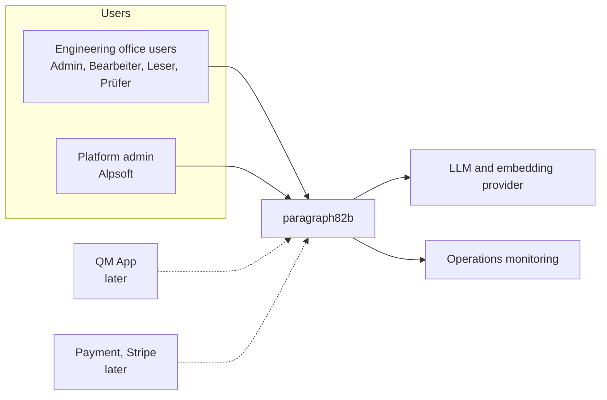
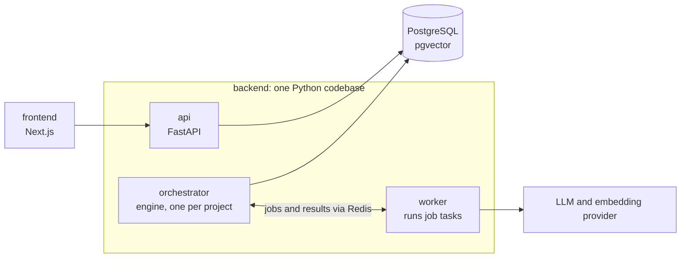
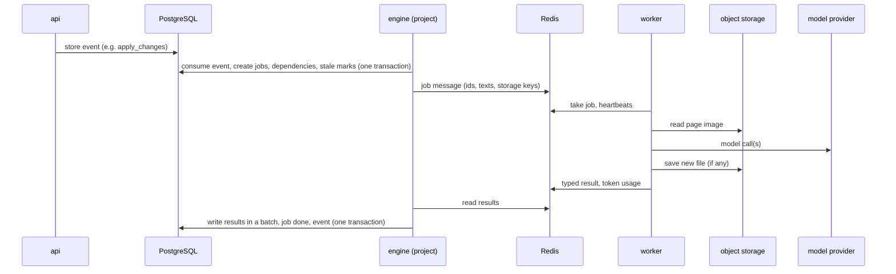
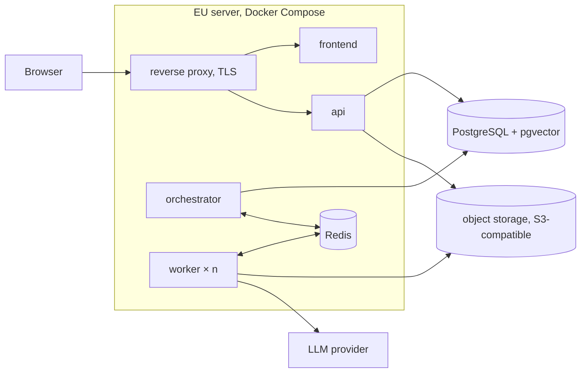

# paragraph82b — Software Architecture

Status: **draft** · Version 6 · 2026-11-18 · Task T-3

Final result only: this file always shows the current architecture. How it got here (versions, decisions,
reasons) is in `Architecture.html`, published as an artifact: https://claude.ai/artifact/W6NpC843bDsLgYiUH15Ljj. Data structures are in [`Data_Model.md`](Data_Model.md); the concept in `infos/`
(referenced by its IDs, e.g. D17, V04).

Markers: **Decided** (name, date) · **Suggestion** (not decided) · **Open** (see [Open decisions](#open-decisions)).

## 1. Scope

- **MVP, platform-wide** (Andreas, 2026-11-18): everything the MVP contains (concept D17) — project and onboarding,
  building the Akt (upload, processing, editor), deriving obligations, inspection (comments, walkthrough checklist,
  risk classification), measures, report with approval and versions, basic roles, tenant separation,
  confidentiality.
- **Prepared, not built** (D17 "Architektur trotzdem vorbereiten für"): tenant types, plans and feature flags,
  project access and transfer, generic inspection duties with interval, interfaces (QM App), iterative processing.
- **Out of scope:** mobile/offline, recurring checks and monitoring, QM App interface, plan analysis, architect and
  authority access, other rulebooks (D17, D18).
- Processing is described in the most depth: it decides the value of the product (D15).

## 2. Quality goals

Taken from the concept; they drive the decisions below.

| Goal | Meaning | Source |
|---|---|---|
| Confidentiality | Business secrets and open defects; platform admins see no customer content by default; every access logged; later encryption per tenant | D06, D14 |
| Fault tolerance | Single pages may fail; processing never aborts, never crashes | A05, D02, D27 |
| Transparency | Every automatic decision is logged, visible and reversible; source chain requirement → page → document | D02 |
| Iterative, non-blocking | Upload more at any time; only new or affected parts are processed; users correct while processing runs | D02, D27 |
| Scale and cost | From ~15 to more than 5,000 pages per Akt; cost per page matters | D27 |
| EU and GDPR | EU hosting, backups, GDPR | D14 |
| Extensibility | Tenant types, plans, rulebooks (Pfade) and interfaces plug in without rewiring the core | D06, D11, D13, D17 |

## 3. Context

- First users: engineering offices, concretely SiBP (D17).
- Payment points towards Stripe (D14); not part of the MVP list (D17) — **Open** whether needed in the MVP.

## 4. Building blocks

**Decided** (Andreas, 2026-11-18, A1; ADR-paragraph-82b-0004): **modular monolith.** One Python codebase
(FastAPI) with strictly separated modules, run as three processes from the same code; the Next.js frontend is
separate.

| Process | Does | Scales by |
|---|---|---|
| api | HTTP API for the frontend: reads, user actions (stored as events), uploads | requests |
| orchestrator | Consumes events per project, schedules jobs, writes job results in batches (section 5) | number of active projects |
| worker | Runs job tasks; no database access; returns typed results | LLM load (pages per minute) |

Why: the rule "consuming an event and its effects is one transaction" needs one database and one codebase; a small
team keeps one deploy; the heavy LLM load still scales on its own through the worker process.

**Modules** (one package each; a module uses another only through its public interface; checked by import rules
in CI):

| Module | Holds | Concept |
|---|---|---|
| identity | tenants, users, roles, project access, feature flags | D43, D06 |
| projects | project (Betriebsobjekt), master data, onboarding | D03, D07 branch 1 |
| akt | files, pages, documents, sections, reference numbers, editor actions | D44, D04, V01–V07 |
| processing | engine (events, scheduling, batch writer) and job type definitions | D15, D27 |
| knowledge | key infos, requirements, evidence, claims, matching, status calculation | D46, D47, V08–V11 |
| notes | notes for the user and the event log | D02 |
| inspection | comments, walkthrough checklist, defects, risk classification | D07 branch 4, D49 |
| measures | measure plan | D07 branch 5, D49 |
| reports | report snapshots, versions, PDF output, office branding | D07 branch 6, D49 |
| rulebooks | Pfade as configuration (e.g. § 82b interval, catalogue) | D11 |
| backoffice | platform admin: plans, support access, feature flags | D06, D14 |
| integration | external API (prepared, not built in the MVP) | D13 |
| billing | plans and payment (prepared, not built in the MVP) | D14, D16 |

Job types live with the module that owns their data (e.g. `ocr_page` in akt, `extract_keyinfos` in knowledge) and
register with the processing engine. **Suggestion**, to be confirmed in A5.

## 5. Processing runtime

Decided so far (data model, section "Architecture, not ER model", and versions v22–v31):

- **Event-driven job pool, not a pipeline** (Andreas, 2026-11-17; ADR-paragraph-82b-0003). Any stage can be reset by
  invalidating its jobs.
- **One orchestrator per project;** projects never reference each other (Andreas, 2026-11-17).
- **Events** are stored in a table and consumed by the project's orchestrator in order. Consuming an event and its
  effects (new jobs, dependencies, stale marks) is one transaction; open events are processed again after a restart
  (Andreas, 2026-11-17, v28). The engine keeps an in-memory view of the project state.
- **Engine and job type definitions** (Andreas, 2026-11-17): to keep the orchestrator from becoming a god object,
  a generic engine (event intake, scheduling with the concurrency check, batch writer) plus one definition per job
  type: precondition, inputs, task, how its result is written, what it invalidates, follow-up candidates.
- **Follow-ups are candidates:** the engine checks each candidate's precondition and starts it only when it holds
  (e.g. a border needs every page of its window read) (Andreas, 2026-11-17).
- **Concurrency rule:** a job starts only when none of its write targets is used by a running job and none of its
  read targets is being written (JOB_TARGET read/write).
- **Jobs do not touch the database.** A job's task returns its own typed result; the orchestrator collects results
  and writes them in batches (Andreas, 2026-11-17). Finishing a job (write results, set done, record the event) is
  one transaction (v28).
- **Failures** (Andreas, 2026-11-17, v23): a temporary failure is retried at once with a higher timeout; if that
  fails, it is lasting — job failed, a note on the failed object, new jobs only after user input. A failure never
  blocks other jobs; jobs that depend on missing or invalid data do not start.
- **Restart** (v28): running jobs go back to queued (attempt + 1); a worker without heartbeat is treated the same.
  Token usage of a crashed attempt may be lost.
- **Consistency check** (v29): from time to time (e.g. when a project is idle) waiting jobs must still wait for
  something and running jobs must have a live worker; findings go to monitoring.
- **User changes** are collected and processed on "Apply changes", like "Start run" (Andreas, 2026-11-17).
- **Job types** up to key info extraction: see `Data_Model.md`, "Job types".

### Runtime (A5)

**Decided** (Andreas, 2026-11-18, A5; ADR-paragraph-82b-0007):

- **Many projects per orchestrator process.** An `orchestrator` process hosts one engine per active project (an
  asyncio task). A project is claimed exclusively through a PostgreSQL lock, so several orchestrator processes can
  share the projects and one takes over after another crashed. Idle projects are unloaded.
- **Redis as message channel.** The engine puts runnable jobs with their inputs into a Redis job stream; workers take
  them, send heartbeats and post typed results to a result stream that the engines read. A job taken but not
  acknowledged by a dead worker is detected and goes back to queued (restart rule above).
- **Large inputs through object storage.** A job message holds ids, texts and object-storage keys. The worker reads
  images straight from object storage and saves new files there (e.g. a turned page), returning the key in its
  result. Workers never touch the database.

- Redis holds only messages in transit; PostgreSQL stays the source of truth (jobs, events, results). After a Redis
  loss the engine re-sends queued jobs from the database.

### Job pool, fairness and model limits

**Decided** (Andreas, 2026-11-18):

| Place | Holds | Purpose |
|---|---|---|
| JOB table (PostgreSQL) | all jobs of all projects in every status, with project_id | source of truth, restart, progress |
| job streams (Redis) | only runnable jobs of all projects | what workers take from |

- **One shared pool.** Workers belong to no project and no orchestrator; they take whatever runnable job comes next,
  so they work where most is needed. A job message carries project_id, job type and the result stream of the
  orchestrator process that holds the project; the worker posts its result there. A late result for an orchestrator
  that died is lost; the job runs again under the new owner (restart rule).
- **Cap per project.** An engine keeps at most N of its jobs in the pool at once (queued plus running; N in
  configuration). It holds back the rest and adds more as results arrive, so a 5,000-page Akt cannot crowd out a
  small project.
- **Priority stream for user actions.** Jobs created by "Apply changes" go into a second stream that workers check
  first, so corrections in the editor come back quickly while a large Akt runs.
- **Semaphore per model.** Before a model call, an AI job takes a slot of a shared semaphore for its model (as
  configured per job type, section 6; size in configuration). Jobs without a model call skip it.
  - No free slot: the job goes back to the pool with a short, growing delay (no busy loop); the worker takes the next
    job.
  - Slots are leases with an expiry, extended by the worker's heartbeat; a dead worker's slot frees itself.
  - Going back to the pool is not a failure: it counts as no attempt and does not raise the timeout. A provider's
    rate-limit answer (HTTP 429) is handled the same way.
  - Limits on tokens per minute are not covered; a token bucket can be added later on the same principle.

| Mechanism | Solves |
|---|---|
| semaphore per model | provider rate limits and load |
| cap per project | fairness between projects |
| priority stream | quick feedback on corrections |
- **Suggestion** (from A1, still to confirm): job types live with the module that owns their data and register with
  the processing engine.

## 6. AI models and flows

**Decided** (Andreas, 2026-11-18, A3 and A4; ADR-paragraph-82b-0006):

- **Modular per job type.** Each job type that calls a model names its model in configuration (provider, model,
  parameters). A job type's model can be switched on its own, when another model fits that step better; nothing else
  changes.
- **Start:** all job types use the OpenAI API with one API key (environment variable, never in the repository).
- **AI flows with LangChain and LangGraph.** A job's task runs its flow (a LangChain call or a LangGraph graph) inside
  the worker and returns the job's typed result; flows never touch the database (section 5).
- **Allowed providers** (A3): providers with processing in the EU and storage of the content excluded by contract,
  US or European. **Open:** check the OpenAI account's terms (data retention, region) before real customer data is
  processed in prod.
- **Token usage** is recorded per call (model, input, reasoning, output) and returned with the job result; the
  orchestrator writes TOKEN_USAGE (data model).

| Job type (up to key info extraction) | Model use |
|---|---|
| ocr_page | vision model: classify page, read text, page features |
| embed_page, embed_keyinfo | embedding model |
| find_sections, classify_document, extract_keyinfos | text model |
| ingest_file, decide_border, assemble_document, duplicate checks, check_reference_numbers | no model (code), unless decided otherwise per job type |

Consequences and guidelines:
- **Embeddings:** the vector size is fixed per column; changing the embedding model means re-embedding every page and
  key info of a project. Store the embedding model name with the vectors. **Suggestion**, to confirm in the data
  model.
- **LangGraph state:** nodes return only the fields they change. Returning the whole state with an adding reducer
  counts token usage several times (seen in the prototype).
- Quality and cost per job type are compared on test data before a model is switched (A13).

## 7. Data and storage

- PostgreSQL with pgvector (Andreas, 2026-11-17, same stack as the prototype); embeddings per page and per key info
  (data model v15, v16).
- Files and page images live in S3-compatible object storage; workers read and write there directly (A5).
  **Open** (A6): provider, local setup, key layout, encryption, retention.
- **Open** (A7): how tenants are separated.

## 8. Security and confidentiality

Principles from D06 (platform admins see no customer content, time-limited support access with customer consent,
every access logged and visible to the customer, real loss of access after revocation, later encryption per
tenant). **Open** (A7, A8): technical realisation.

## 9. Observability

- Two separate stores (Andreas, 2026-11-17): EVENT table = project history for users and the orchestrator's input;
  a log/metrics store for the operator across projects (job durations, failure rates, retries, queue length, worker
  heartbeats, token usage over time). Matches D14 ("Logging / Ereignisprotokoll" and "Systemmonitoring").
- Monitoring holds only ids, counts and durations, no customer content (D06).
- **Open** (A12): concrete stack (the data model names Grafana as an example).

## 10. Deployment and environments

**Decided** (Andreas, 2026-11-18, A2; ADR-paragraph-82b-0005): **containers on rented servers of a European
provider**, run with Docker Compose, as in the prototype. No US cloud provider holds customer data.

| Environment | Purpose | Who works there |
|---|---|---|
| local | development and tests; the only place agents work | developers, agents |
| dev | live test version | people only |
| prod | customers | people only |

- Every environment runs the same images; configuration through environment variables only (names, never values,
  in the repository).
- Workers scale by running more `worker` containers (by hand in the MVP).
- Backups of the database and the object storage are our job (no managed service assumed).
- **Suggestion** (from the prototype, to confirm): Caddy as reverse proxy with automatic TLS; images in the GitHub
  container registry; build and deploy with GitHub Actions.
- **Open:** the concrete provider and location (AT/DE); managed or self-run PostgreSQL; backup schedule and
  retention; whether object storage comes from the same provider (A6).

## Open decisions

Worked through one at a time, in this order (later ones depend on earlier ones).

| ID | Decision | Depends on |
|---|---|---|
| A6 | Object storage details: provider, local setup, key layout, encryption, retention | A2 |
| A7 | Tenant separation and confidentiality measures | A1 |
| A8 | Authentication, roles, feature flags (four dimensions, D06) | A7 |
| A9 | Frontend–backend API and live progress | A1 |
| A10 | Report and checklist generation (PDF, branding) | A1 |
| A11 | Rulebooks (Pfade) as configuration | A1 |
| A12 | Observability stack | A2 |
| A13 | Testing and measuring processing quality without labelled data (A07) | — |
