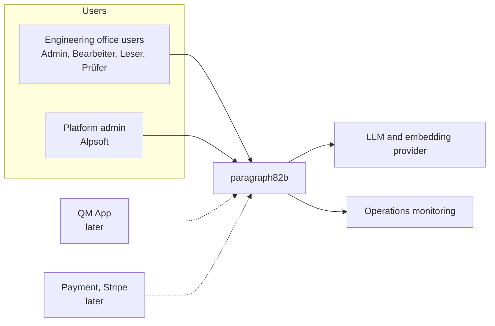

# paragraph82b — Software Architecture

Status: **draft** · Version 1 · 2026-11-18 · Task T-3

Final result only: this file always shows the current architecture. How it got here (versions, decisions,
reasons) is in `Architecture.html`, published as an artifact: https://claude.ai/artifact/W6NpC843bDsLgYiUH15Ljj. Data structures are in [`Data_Model.md`](Data_Model.md); the concept in `infos/`
(referenced by its IDs, e.g. D17, V04).

Markers: **Decided** (name, date) · **Suggestion** (not decided) · **Open** (see [Open decisions](#open-decisions)).

## 1. Scope

- **MVP, platform-wide** (Andreas, 2026-11-18): everything the MVP contains (concept D17) — project and onboarding,
  building the Akt (upload, processing, editor), deriving obligations, inspection (comments, walkthrough checklist,
  risk classification), measures, report with approval and versions, basic roles, tenant separation,
  confidentiality.
- **Prepared, not built** (D17 "Architektur trotzdem vorbereiten für"): tenant types, plans and feature flags,
  project access and transfer, generic inspection duties with interval, interfaces (QM App), iterative processing.
- **Out of scope:** mobile/offline, recurring checks and monitoring, QM App interface, plan analysis, architect and
  authority access, other rulebooks (D17, D18).
- Processing is described in the most depth: it decides the value of the product (D15).

## 2. Quality goals

Taken from the concept; they drive the decisions below.

| Goal | Meaning | Source |
|---|---|---|
| Confidentiality | Business secrets and open defects; platform admins see no customer content by default; every access logged; later encryption per tenant | D06, D14 |
| Fault tolerance | Single pages may fail; processing never aborts, never crashes | A05, D02, D27 |
| Transparency | Every automatic decision is logged, visible and reversible; source chain requirement → page → document | D02 |
| Iterative, non-blocking | Upload more at any time; only new or affected parts are processed; users correct while processing runs | D02, D27 |
| Scale and cost | From ~15 to more than 5,000 pages per Akt; cost per page matters | D27 |
| EU and GDPR | EU hosting, backups, GDPR | D14 |
| Extensibility | Tenant types, plans, rulebooks (Pfade) and interfaces plug in without rewiring the core | D06, D11, D13, D17 |

## 3. Context

- First users: engineering offices, concretely SiBP (D17).
- Payment points towards Stripe (D14); not part of the MVP list (D17) — **Open** whether needed in the MVP.

## 4. Building blocks

**Open** (A1): system shape, containers and module boundaries.

Module candidates from the concept (D14, D17), to be cut in A1:
identity and access · projects and onboarding · Akt (files, pages, documents, editor) · processing engine ·
knowledge (key infos, requirements, evidence, matching) · notes and events · inspection (comments, walkthrough,
defects, risk) · measures · reports (snapshot, PDF, branding) · rulebooks (Pfade) · backoffice ·
integration API (prepared) · billing (prepared).

## 5. Processing runtime

Decided so far (data model, section "Architecture, not ER model", and versions v22–v31):

- **Event-driven job pool, not a pipeline** (Andreas, 2026-11-17; ADR-paragraph-82b-0003). Any stage can be reset by
  invalidating its jobs.
- **One orchestrator per project;** projects never reference each other (Andreas, 2026-11-17).
- **Events** are stored in a table and consumed by the project's orchestrator in order. Consuming an event and its
  effects (new jobs, dependencies, stale marks) is one transaction; open events are processed again after a restart
  (Andreas, 2026-11-17, v28). The engine keeps an in-memory view of the project state.
- **Engine and job type definitions** (Andreas, 2026-11-17): to keep the orchestrator from becoming a god object,
  a generic engine (event intake, scheduling with the concurrency check, batch writer) plus one definition per job
  type: precondition, inputs, task, how its result is written, what it invalidates, follow-up candidates.
- **Follow-ups are candidates:** the engine checks each candidate's precondition and starts it only when it holds
  (e.g. a border needs every page of its window read) (Andreas, 2026-11-17).
- **Concurrency rule:** a job starts only when none of its write targets is used by a running job and none of its
  read targets is being written (JOB_TARGET read/write).
- **Jobs do not touch the database.** A job's task returns its own typed result; the orchestrator collects results
  and writes them in batches (Andreas, 2026-11-17). Finishing a job (write results, set done, record the event) is
  one transaction (v28).
- **Failures** (Andreas, 2026-11-17, v23): a temporary failure is retried at once with a higher timeout; if that
  fails, it is lasting — job failed, a note on the failed object, new jobs only after user input. A failure never
  blocks other jobs; jobs that depend on missing or invalid data do not start.
- **Restart** (v28): running jobs go back to queued (attempt + 1); a worker without heartbeat is treated the same.
  Token usage of a crashed attempt may be lost.
- **Consistency check** (v29): from time to time (e.g. when a project is idle) waiting jobs must still wait for
  something and running jobs must have a live worker; findings go to monitoring.
- **User changes** are collected and processed on "Apply changes", like "Start run" (Andreas, 2026-11-17).
- **Job types** up to key info extraction: see `Data_Model.md`, "Job types".

**Open** (A5): how orchestrators and workers run and talk to each other (process model, transport, how inputs reach
a worker that does not touch the database).

## 6. Data and storage

- PostgreSQL with pgvector (Andreas, 2026-11-17, same stack as the prototype); embeddings per page and per key info
  (data model v15, v16).
- **Open** (A6): where files and page images are stored.
- **Open** (A7): how tenants are separated.

## 7. Security and confidentiality

Principles from D06 (platform admins see no customer content, time-limited support access with customer consent,
every access logged and visible to the customer, real loss of access after revocation, later encryption per
tenant). **Open** (A7, A8): technical realisation.

## 8. Observability

- Two separate stores (Andreas, 2026-11-17): EVENT table = project history for users and the orchestrator's input;
  a log/metrics store for the operator across projects (job durations, failure rates, retries, queue length, worker
  heartbeats, token usage over time). Matches D14 ("Logging / Ereignisprotokoll" and "Systemmonitoring").
- Monitoring holds only ids, counts and durations, no customer content (D06).
- **Open** (A12): concrete stack (the data model names Grafana as an example).

## 9. Deployment and environments

**Open** (A2). Agents develop and test only locally (AGENTS.md).

## Open decisions

Worked through one at a time, in this order (later ones depend on earlier ones).

| ID | Decision | Depends on |
|---|---|---|
| A1 | System shape: modular monolith vs services; containers; module boundaries | — |
| A2 | Hosting and deployment (EU), environments | A1 |
| A3 | LLM and embedding providers, EU data residency | A2 |
| A4 | LLM integration layer: LangChain/LangGraph vs own thin layer (D19 asks to check) | A3 |
| A5 | Orchestrator and worker runtime, job transport, worker inputs | A1 |
| A6 | File and image storage | A2 |
| A7 | Tenant separation and confidentiality measures | A1 |
| A8 | Authentication, roles, feature flags (four dimensions, D06) | A7 |
| A9 | Frontend–backend API and live progress | A1, A5 |
| A10 | Report and checklist generation (PDF, branding) | A1 |
| A11 | Rulebooks (Pfade) as configuration | A1 |
| A12 | Observability stack | A2 |
| A13 | Testing and measuring processing quality without labelled data (A07) | A4, A5 |
