# paragraph82b — Data Model

Status: **draft** · current version **v32** · 2026-11-17

Single end result: this file shows the current model. How it got here is in the [history](#history). Converted from the earlier `Data_Model.html` (2026-11-18); English names, each mapped to a concept term (see Terms). How the software works (orchestrator, workers, monitoring) is in [`Architecture.md`](Architecture.md).

Scope (Andreas, 2026-11-17): processing up to key info extraction. Added later, once the steps up to them work: user actions on sections, key infos, requirements, evidence and claims; the steps after key info extraction. Out of scope: tenants. No open model questions remain for this scope.

## Terms

English model ↔ German concept

Code and model use English names; each maps to one term of the concept (Andreas, 2026-11-16). Terms marked "suggestion" have no settled concept word yet.

| Model (English) | Concept (German) | Note |
|---|---|---|
| PROJECT | Betriebsobjekt / Projekt | D03 |
| USER | Nutzer | D43 |
| PROJECT_ACCESS | Zugriff | D43 |
| FILE | Datei (ein Upload) | agreed |
| PAGE | Seite | D44 |
| DOCUMENT | Dokument | D44 |
| DOCUMENT_SECTION | Abschnitt | D04, V06 |
| REFERENCE_NUMBER | Geschäftszahl | D04, D40; "Zahl", "GZ", "Aktenkennzahl" in the prototype |
| KEYINFO | Key-Info | D46; here only the verbatim text section |
| REQUIREMENT | Auflage (Unterauflage when it has a parent) | D47, D42 |
| REQUIREMENT.point | Auflagenpunkt / Nummer | D04 |
| EVIDENCE | Bestätigung / Nachweis | D47, V11 |
| EVIDENCE.kind | erfüllt, teilweise erfüllt, mangelhaft, nicht erfüllt, hinfällig | values stay German |
| EVIDENCE_CLAIM | Zuordnung | agreed |
| NOTE | Hinweis | agreed |
| JOB | Verarbeitungsschritt | agreed |

## User actions on the job pool

Status: in progress

An orchestrator reacts to events (job finished, user action), checks each job type's preconditions and puts only runnable jobs into the pool; workers run them. Each action invalidates everything below the changed object within its scope. Sections, key infos, requirements, evidence and claims are left out of this round (Andreas, 2026-11-17). Decided (Andreas, 2026-11-17): user actions on these are added later, once the processing steps up to them work.

| Action | Invalidates | Orchestrator queues |
|---|---|---|
| Start run | – | Everything whose precondition is met |
| Cancel | Nothing; the pool is cleared and the orchestrator adds nothing new; at most some token usage remains. No cancel of single jobs (Andreas, 2026-11-17) | – |
| Rerun | Everything (with warning) | Everything, from OCR |
| Upload files | – | OCR of the new pages, then grouping of the new pages |
| Remove file | Its pages, then as "remove page" | Rebuild of affected documents |
| Remove page | Its document from sections down | Same |
| Reorder pages in a document | That document from sections down | Same |
| Move page to another document | Both documents from the classification down (type, date, reference numbers) (Andreas) | Same for both |
| Re-read page | The page, then its document | OCR, then the document |
| Turn a page by hand (automatic rotation wrong) | The page (turned version saved), then its document | OCR, then the document (Andreas, 2026-11-17) |
| Take a page out of its document / assign a free page | The one document affected, as for "move" | Same (Andreas, 2026-11-17) |
| Replace a page with a better photo | Via the duplicate flow: new page uploaded, old page marked duplicate; key infos on the old page are handled like a key info across a moved page (note, then rebuild) | Same (Andreas, 2026-11-17) |
| Change page classification | Its document | Same |
| Mark page duplicate / original | Its document | Same |
| Split document | Becomes two documents, each from the type down | Same for both |
| Join documents | Become one, from the type down | Same |
| Create document from free pages | – | Type, sections … |
| Remove document | Its pages are removed from further processing too (Andreas) | – |
| Change document type | Sections down | Sections … |
| Change document date | Nothing structural; status calculation | – |
| Edit / add / remove reference number | Matching of claims pointing to it | Matching |
| Mark document duplicate / original | Its key infos stop counting | Matching of affected claims |
| Bring back a page or document marked duplicate | Duplicates are never processed further, so it is treated like a new upload | Processing as for an upload (Andreas, 2026-11-17) |
| Link a reference number without document to a later document | Suggested by a note; the user confirms | Matching of claims pointing to it (Andreas, 2026-11-17) |

### Open

Rebuilt document (Andreas, 2026-11-17): pages do not change and key infos are attached to pages, so key infos (with their requirements, evidence, claims and user data) survive a rebuild. Only a key info that spans several pages including a moved or removed page is affected. Decided (Andreas, 2026-11-17):

- Line numbers start again on every page.
- After the sections are rebuilt, each surviving key info is re-attached to the new section covering its page and line.
- A key info that spans a moved or removed page held text from what are really separate documents, so it was wrong anyway; losing it and what hangs on it is acceptable. It triggers a note. When the user dismisses the note, the whole document and its key infos are rebuilt.
- If a move changes the document type, this also triggers a note; dismissing it rebuilds the document and its key infos (Andreas, 2026-11-17).
- Decided (Andreas, 2026-11-17): no soft delete; deleting is final after a confirmation, since soft delete loses the cascade (v32).
- Decided (Andreas, 2026-11-17): user changes are collected and processed on "Apply changes", like "Start run". May change later.
- Not now: correcting OCR text by hand; correcting page features by hand (the user splits the document instead) (Andreas, 2026-11-17).
- Not now: changing onboarding answers (Andreas, 2026-11-17).

Failing jobs: decided, see v23.

## Job types

Status: up to key info extraction

One job type per unit of work and object. Modelled up to key info extraction; the steps after it (evaluation into requirements and evidence, matching, evidence search V11) are decided later, and may be split into smaller steps, since errors from earlier stages made the prototype's checks there unreliable (Andreas, 2026-11-17).

| Job type | Per | Reads | Writes | Precondition | Follow-up candidates |
|---|---|---|---|---|---|
| ingest_file | File | File | Pages (image, index in file, position) | File uploaded | ocr_page per page; check_file_duplicate |
| check_file_duplicate | File | content_hash | Note if suspected | ingest_file done | – |
| ocr_page | Page | Page image | Text, PAGE_FEATURES, classification; turned image if needed (turn, save, read again inside the job) | Page exists | embed_page (if akt); decide_border for each border whose window holds the page; check_page_duplicate |
| embed_page | Page | Text | PAGE.embedding | ocr_page done | – |
| check_page_duplicate | Page | Text and embedding of pages | Note if suspected | embed_page done | – |
| decide_border | Pair of neighbouring pages | PAGE_FEATURES of the window | border_before, border_score, border_rules | ocr_page done for every page in the window | assemble_document once a stretch has decided borders at both ends |
| assemble_document | Stretch of pages | Pages, borders | Document; document_id, position on its pages | Both borders decided | find_sections; check_document_duplicate |
| check_document_duplicate | Document | Texts of documents | Note if suspected | assemble_document done | – |
| find_sections | Document | Document text, title-page features | Sections; DOCUMENT_FEATURES (authority or not, which sections were found) | assemble_document done | classify_document |
| classify_document | Document | DOCUMENT_FEATURES, pages | document_type, short_title, stated_date, reference numbers (new, or linked to one without document) | find_sections done | extract_keyinfos per relevant section; check_reference_numbers |
| check_reference_numbers | Project | Reference numbers, dates | Notes (possible duplicates, date conflicts) | A reference number added or changed | – |
| extract_keyinfos | Section | Section text | Key infos (verbatim, page and line) | classify_document done | embed_keyinfo per key info; later steps to be decided |
| embed_keyinfo | Key info | Text | KEYINFO.embedding | extract_keyinfos done | – |

Decided (Andreas, 2026-11-17): page turning stays inside ocr_page; duplicate checks are separate job types per level (file, page, document). Decided (Andreas, 2026-11-17): find_sections runs before the type is known: every document first gets a root section over the whole document, then all candidate section types are looked for beneath it; what was found is reported in DOCUMENT_FEATURES, which classify_document and later steps use.

## Entity-relationship diagram (v32)

```mermaid
erDiagram
USER ||--o{ PROJECT : owns
USER ||--o{ PROJECT_ACCESS : receives
PROJECT ||--o{ PROJECT_ACCESS : grants
PROJECT ||--o{ FILE : receives
USER o|--o{ FILE : uploads
FILE ||--|{ PAGE : yields
PROJECT ||--o{ DOCUMENT : contains
DOCUMENT o|--o{ PAGE : groups
DOCUMENT ||--o| DOCUMENT_FEATURES : described_by
PAGE ||--o| PAGE_FEATURES : described_by
PROJECT ||--o{ REFERENCE_NUMBER : knows
DOCUMENT o|--o{ REFERENCE_NUMBER : carries
DOCUMENT ||--o{ DOCUMENT_SECTION : has
DOCUMENT_SECTION o|--o{ DOCUMENT_SECTION : parent_of
PAGE ||--o{ DOCUMENT_SECTION : start_boundary
PAGE ||--o{ DOCUMENT_SECTION : end_boundary
PROJECT ||--o{ KEYINFO : contains
DOCUMENT_SECTION o|--o{ KEYINFO : originates
PAGE o|--o{ KEYINFO : starts
PAGE o|--o{ KEYINFO : ends
USER o|--o{ KEYINFO : authors
KEYINFO ||--o{ REQUIREMENT : stated_as
REQUIREMENT o|--o{ REQUIREMENT : parent_of
KEYINFO ||--o{ EVIDENCE : used_as
EVIDENCE ||--|{ EVIDENCE_CLAIM : claims
REFERENCE_NUMBER o|--o{ EVIDENCE_CLAIM : targets
REQUIREMENT o|--o{ EVIDENCE_CLAIM : matched_by
PROJECT ||--o{ NOTE : has
USER o|--o{ NOTE : resolves
NOTE ||--|{ NOTE_TARGET : concerns
DOCUMENT o|--o{ NOTE_TARGET : target
FILE o|--o{ NOTE_TARGET : target
PAGE o|--o{ NOTE_TARGET : target
REFERENCE_NUMBER o|--o{ NOTE_TARGET : target
KEYINFO o|--o{ NOTE_TARGET : target
REQUIREMENT o|--o{ NOTE_TARGET : target
EVIDENCE_CLAIM o|--o{ NOTE_TARGET : target
PROJECT ||--o{ EVENT : records
USER o|--o{ EVENT : triggers
PROJECT ||--o{ JOB : has
JOB ||--|{ JOB_TARGET : uses
JOB ||--o{ JOB_DEPENDENCY : waits_for
JOB ||--o{ JOB_DEPENDENCY : needed_by
PAGE o|--o{ JOB_TARGET : target
DOCUMENT o|--o{ JOB_TARGET : target
DOCUMENT_SECTION o|--o{ JOB_TARGET : target
KEYINFO o|--o{ JOB_TARGET : target
REQUIREMENT o|--o{ JOB_TARGET : target
EVIDENCE_CLAIM o|--o{ JOB_TARGET : target
PROJECT ||--o{ TOKEN_USAGE : costs
JOB o|--o{ TOKEN_USAGE : records
USER {
uuid id PK
string name
string email
string role
string pwd_hash
}
PROJECT {
uuid id PK
uuid owner_user_id FK
string name
string address
string tier
datetime created_at
datetime updated_at
datetime deleted_at
}
PROJECT_ACCESS {
uuid id PK
uuid project_id FK
uuid user_id FK
string access_tier
}
FILE {
uuid id PK
uuid project_id FK
uuid uploaded_by_user_id FK "nullable"
string file_type "image or pdf"
string original_name
string path
string content_hash
int page_count
int upload_position "order within the upload"
string duplicate_state "nullable, original or duplicate"
datetime uploaded_at
}
PAGE {
uuid id PK
uuid file_id FK
uuid document_id FK "nullable"
int file_page_index "0 for an image"
int position "upload order, restarts at each document border"
string image_path "rendered or rotated version"
string classification "akt, kept, irrelevant"
string border_before "open, new_document, continuation"
float border_score "nullable, confidence 0 to 1 that border_before is right"
jsonb border_rules "nullable, names and points of the rules that fired"
string duplicate_state "nullable, original or duplicate"
text text "OCR text of this page"
vector embedding "nullable, from text"
}
PAGE_FEATURES {
uuid id PK
uuid page_id FK "one per page"
int page_number "nullable, as printed"
int total_page_number "nullable, of x"
string reference_number_raw "nullable, as read on the page"
date date "nullable, as read on the page"
string document_type_hint "nullable"
bool is_text_document
bool is_construction_plan
bool is_irrelevant
bool has_letterhead
bool has_subject
bool has_stamp
bool indicates_new_document
bool indicates_finished_document
bool indicates_continuation
bool title_authority "nullable, title pages only"
bool title_reference_number "nullable"
bool title_gegenstand_der_amtshandlung "nullable"
bool title_ort_der_amtshandlung "nullable"
bool title_beginn_der_amtshandlung "nullable"
bool title_verhandlungsleiter "nullable"
bool title_anwesende_personen "nullable"
bool title_verhandlungsschrift "nullable"
bool title_bescheid "nullable"
bool title_spruch "nullable"
bool title_betreff "nullable"
}
DOCUMENT_FEATURES {
uuid id PK
uuid document_id FK "one per document"
bool is_authority_document
string subtype_hint "nullable, e.g. email, data sheet"
bool has_gegenstand
bool has_organe
bool has_verhandlungsleiter
bool has_verfahrensanordnung
bool has_stellungnahme
bool has_auflagen
bool has_bescheid_spruch
bool has_rechtsgrundlage
bool has_rechtsmittelbelehrung
bool has_verfahrenskosten
bool has_ergeht_an
}
DOCUMENT {
uuid id PK
uuid project_id FK
string document_type
string short_title "nullable, generated"
date stated_date "nullable, date written in the document"
string duplicate_state "nullable, original or duplicate"
}
REFERENCE_NUMBER {
uuid id PK
uuid project_id FK
uuid document_id FK "nullable, null = document missing"
string raw "as read"
string normalized "unique per project"
date stated_date "nullable, known date; also from a Pruefdokument when the document is missing"
}
DOCUMENT_SECTION {
uuid id PK
uuid document_id FK
uuid parent_section_id FK
uuid start_page_id FK
uuid end_page_id FK
int start_line
int end_line
string section_type
}
KEYINFO {
uuid id PK
uuid project_id FK
uuid source_section_id FK "nullable"
uuid start_page_id FK "nullable"
uuid end_page_id FK "nullable"
uuid author_user_id FK "nullable, set for comments"
int start_line "nullable"
int end_line "nullable"
string creation_method "extraction, agent, user, onboarding"
text text "verbatim document text, stored copy"
vector embedding "nullable, from text"
}
REQUIREMENT {
uuid id PK
uuid keyinfo_id FK
uuid parent_requirement_id FK "nullable"
string point_raw "nullable, as written, e.g. 4.2, IV, b)"
int point "nullable, last level as integer"
string category "nullable, 13 subject categories"
interval time_interval "nullable"
text summary "generated"
}
EVIDENCE {
uuid id PK
uuid keyinfo_id FK
string kind "erfuellt, teilweise, mangelhaft, nicht_erfuellt, hinfaellig, ersetzt"
text summary "generated"
}
EVIDENCE_CLAIM {
uuid id PK
uuid evidence_id FK
uuid target_reference_number_id FK "nullable"
uuid requirement_id FK "nullable, null = not matched"
string target_point_raw "nullable, as written"
int target_point "nullable, last level as integer"
string matched_by "code, llm, user"
}
NOTE {
uuid id PK
uuid project_id FK
uuid resolved_by_user_id FK "nullable"
string severity
string status "open, resolved"
text text
text resolution "nullable, what was decided"
datetime created_at
datetime resolved_at "nullable"
}
NOTE_TARGET {
uuid id PK
uuid note_id FK
uuid document_id FK "nullable"
uuid file_id FK "nullable"
uuid page_id FK "nullable"
uuid reference_number_id FK "nullable"
uuid keyinfo_id FK "nullable"
uuid requirement_id FK "nullable"
uuid evidence_claim_id FK "nullable"
}
EVENT {
uuid id PK
uuid project_id FK
uuid user_id FK "nullable, set for user events"
string origin "user or autonomous"
string event_type "e.g. page_removed, job_done, apply_changes"
jsonb details "ids and labels of the objects concerned, roles (from, to), old and new values"
datetime created_at
datetime processed_at "nullable"
}
JOB_DEPENDENCY {
uuid id PK
uuid job_id FK "the waiting job"
uuid depends_on_job_id FK "must be done first"
}
JOB_TARGET {
uuid id PK
uuid job_id FK
string access "read or write"
uuid page_id FK "nullable"
uuid document_id FK "nullable"
uuid section_id FK "nullable"
uuid keyinfo_id FK "nullable"
uuid requirement_id FK "nullable"
uuid evidence_claim_id FK "nullable"
}
JOB {
uuid id PK
uuid project_id FK
string job_type "task to run; preconditions per type in code"
string status "waiting, queued, running, done, failed"
int attempts
int timeout_seconds "raised on retry"
string worker_id "nullable"
text error "nullable"
datetime created_at
datetime started_at "nullable"
datetime heartbeat_at "nullable"
datetime finished_at "nullable"
}
TOKEN_USAGE {
uuid id PK
uuid project_id FK
uuid job_id FK "nullable, cleared when the job is deleted"
string job_type "kept when the job is gone"
datetime created_at
int input
int reasoning
int output
string model
}
```

## Open questions

Status: tidied 2026-11-17

### Open, in scope

- Nothing open for the current scope (2026-11-17).
- Keeping history: no soft delete, deleting is final after a confirmation; soft delete loses the cascade (v32).
- DOCUMENT short title: generated, v32.
- Mixed sources: a document may hold pages from several files, e.g. several photos; a photo series does not continue a PDF document (v32).

### Deferred until the steps before them work (Andreas, 2026-11-17)

- Processing steps after key info extraction (evaluation, matching, V11 search), possibly split further.
- Conflicting evidence on one requirement: newer counts more (stated date); the exact rule belongs to matching.
- User actions on sections, key infos, requirements, evidence and claims, including human overrides of a requirement's status (D02) and the reasoning shown with it.
- Correcting OCR text or page features by hand.
- Recognising duplicate reference numbers (OCR misreads): implementation detail; the outcome is already modelled as a note suggesting a merge.

### Out of scope

- Tenants, plans, roles per tenant, project master data (concept D43, D05, D06, D10).

### Needs Thomas's agreement (deviations from the concept)

- Key info split into KEYINFO, REQUIREMENT, EVIDENCE, EVIDENCE_CLAIM; the concept (D46) has one shared Key-Info object.
- A rerun deletes everything, including what people entered, after a warning (D02: "human corrections are never overwritten").
- A missing document is a REFERENCE_NUMBER without document, not an empty Bescheid (D04).
- Duplicates are decided by the user through notes and marked with duplicate_state (D02, V04).
- No tenant (D43).

### Decided, kept for reference

- Rerun (Andreas, 2026-11-16): a rerun deletes everything, including what people entered (comments, matches set by hand, corrected summaries). Before it runs, the user confirms a warning that this cannot be undone. Only the rerun itself is kept as a user event.
- Values of EVIDENCE.kind (Andreas, 2026-11-16/17): more may follow.
  - erfüllt, hinfällig and ersetzt end the processing of the requirement; all others need further processing.
  - ersetzt: a Bescheid repeats a requirement of a Verhandlungsschrift; the old requirement is replaced by the Bescheid's. Preferably set on the parent requirement; the model also allows it on a child. A Verhandlungsschrift requirement the Bescheid does not repeat stays open.
  - mangelhaft: something was done, but not enough or wrong. Concept D04 "ergänzt" counts as mangelhaft.
  - nicht erfüllt: nothing found, or a document states it is not fulfilled.
  - teilweise erfüllt: a passage states it, or a child requirement is teilweise erfüllt.
- Status is calculated, not stored (Andreas, 2026-11-16): from the matched evidence (EVIDENCE.kind via the claims) and the child requirements. EVIDENCE.kind holds what a passage says. Newer information counts more; "newer" means the date stated in the document, not the upload date.
- Parent status (Andreas, 2026-11-17): a parent with its own terminating status (erfüllt, hinfällig, ersetzt) keeps it and does not look at its children. Otherwise its status is strictly the worst child status; its own non-terminating evidence no longer counts. Reason: there can always be newer information not found yet. Order from worst to best: nicht erfüllt < mangelhaft < teilweise erfüllt < ersetzt < hinfällig < erfüllt. Example: children {nicht erfüllt, erfüllt} give nicht erfüllt.
- Borders (Andreas, 2026-11-17): border_score is a confidence (0 to 1); border_rules keeps the rules that fired; no grey-zone value, a low confidence creates a note (v31).

### Solved in later versions

- Requirement has no Auflage number: point_raw and point, v7/v11.
- Document lacks Geschäftszahl and date; several per document: REFERENCE_NUMBER v9–v12, DOCUMENT.stated_date v6.
- No author or context on KEYINFO: author_user_id v4; comments via NOTE and NOTE_TARGET, v13.
- No event log: EVENT, v26.
- Order of pages, sequence: position is enough, v17.
- Embedding per page: column on PAGE, v15.
- Job target link or dependency table: both, JOB_TARGET v24 and JOB_DEPENDENCY v28.
- Requirement side (v3 list): number v7; status calculated (v5); superseded_by replaced by kind ersetzt, v22; origin always a key info, v21; derived_from not needed. Override marker and reasoning: deferred (see above).
- Requirement and KeyInfo as separate tables: kept and refined; needs Thomas (see above).
- No tenant: out of scope.

## Review per table

Status: done

Missing fields and open decisions, table by table. Gone through on 2026-11-17; what is left open is listed under "Open questions".

| Table | Missing or undecided | Source |
|---|---|---|
| PROJECT, USER, TENANT | Out of scope (Andreas, 2026-11-17): tenants, plans and roles per tenant hardly affect how a project is processed, so this model leaves them out. USER, PROJECT and PROJECT_ACCESS stay as placeholders. Tenant, plan, roles and project master data (Branche, onboarding answers) are modelled separately later. | Concept D43, D05, D06, D10 |
| DOCUMENT | Short title: short_title, v32. Document-level duplicate: duplicate_state, v18. Empty Bescheid as document without pages: replaced by a REFERENCE_NUMBER without document, v12 | Prototype, D04 |
| PAGE | sequence: not needed, decided in v17. Embedding: on the page, decided in v15 | A02, V03 |
| DOCUMENT_SECTION | Decided (Andreas, 2026-11-17): section types depend on the document type. Bescheide and Verhandlungsschriften have a clear, predictable layout, so a fixed set of types is looked for (prototype: Gegenstand, Stellungnahme, Bescheid/Spruch, Auflagen, Verfahrenskosten, Rechtsmittelbelehrung, Rechtsgrundlage, …). Every document (authority or not) gets a root section over the whole document; further sections sit beneath it (Andreas, 2026-11-17). Consequence: every document has at least one section, so a key info from a document always has a source_section_id. The allowed types per document type live in the code configuration for now (Andreas, 2026-11-17). | D04, V06 |
| REQUIREMENT | Auflage number (added in v7); superseded_by: no column. Decided (Andreas, 2026-11-17): when a Bescheid repeats requirements of a Verhandlungsschrift, the Bescheid passage becomes a key info whose evidence has one claim per repeated requirement. All evidence already matched to the Verhandlungsschrift requirement moves to the Bescheid requirement, the more relevant document. This evidence gets the new kind ersetzt, which ends the old requirement like hinfällig (Andreas, 2026-11-17). Decided (Andreas, 2026-11-17): ersetzt is preferably set on the parent requirement, which fits the domain better; the model also allows it on single child requirements. A Verhandlungsschrift requirement the Bescheid does not repeat stays an open requirement and is evaluated like any other. origin when there is no key info (always a key info, v21); derived_from: not needed. Decided (Andreas, 2026-11-17): a sub-requirement keeps its own key info (verbatim, e.g. a Brandschutzplan point) and its parent; which evidence led to it is traced through the document (its key info and the evidence's key info sit in the same document). subject category: kept, v22 | V10, D04, D42 |
| EVIDENCE_CLAIM | Raw Geschäftszahl and date on the claim: not needed, decided in v7 | V10, D04 |
| EVENT_LOG (new) | Automatic decisions, corrections, accesses: EVENT with origin user or autonomous, v26; accesses go to the separate monitoring store | Concept D02, D03, D06 |
| REFERENCE_NUMBER | How possibly identical numbers (OCR misreads) are recognised: an implementation detail, decided by trying what works best. The model already covers the outcome: a suspected duplicate is flagged with a note that suggests a merge, and the user merges (Andreas, 2026-11-16, confirmed 2026-11-17) | v12 |
| NOTE | Decided (Andreas, 2026-11-16): every data conflict (possible duplicate numbers, document date vs number date, …) creates a note for the user, since the system cannot guess the right answer. Decided in v13: link table NOTE_TARGET (variant a). How a note points to what it is about. Today one nullable column per target type, only one used. A conflict usually concerns two or more objects (two numbers, a document and its number). Options: (a) a link table NOTE_TARGET with several targets per note; (b) target_type + target_id as in JOB, no foreign keys; (c) one nullable column per type with a check that exactly one is set. Open/resolved, who and how: added in v14. | v12 |
| JOB | Shape of the job pool: JOB_TARGET v24, JOB_DEPENDENCY v28 | Open question v2 |

Changes v7 → v8

2026-11-16

| Change | What | Why |
|---|---|---|
| new | ZAHL: a Geschäftszahl of the project, on its own, once per normalized form | A Zahl without any document shows that a document is missing (Andreas, 2026-11-16); no empty placeholder document needed |
| changed | DOCUMENT_ZAHL is now the link document ↔ Zahl, with the Zahl as read on that document | A document can carry several Zahlen, and one Zahl often appears on several documents (Verhandlungsschrift and Bescheid of the same proceeding) |
| changed | EVIDENCE_CLAIM.target_document_id → target_zahl_id | A claim can point to a Zahl whose document is not in the file |
| new | EVIDENCE_CLAIM.target_date (nullable) | Prüfdokumente name Zahl and date; the date tells apart several documents under one Zahl |

Differs from concept D04, which creates an empty Bescheid document; goes to Thomas. ZAHL also comes close to the "Verfahren" proposal in D45 (a proceeding identified by its Geschäftszahl).

Changes v6 → v7

2026-11-16

| Change | What | Why |
|---|---|---|
| new | REQUIREMENT.number: the Auflage number as written (text, e.g. "4", "4.2", "III") | Matching by Geschäftszahl + number compares it with EVIDENCE_CLAIM.target_point |
| decided | No Geschäftszahl stored on the claim. It is read from the key info's text and the documents (DOCUMENT_ZAHL) and resolved straight to target_document_id | Andreas, 2026-11-16; a reviewed Bescheid missing from the file is the empty Bescheid document of concept D04, so the target is always a document |
| derived | A requirement's Geschäftszahl comes from its key info's document | No second copy on the requirement |

Changes v5 → v6

2026-11-16

| Change | What | Why |
|---|---|---|
| new | DOCUMENT.stated_date: the date written in the document (nullable when unreadable) | Newer information counts more; the upload date says nothing about history |
| new | DOCUMENT_ZAHL: Geschäftszahlen of a document, as read and normalized | A document can carry several (D40); OCR often misreads them, so matching compares the normalized form |
| decided | Date and Geschäftszahl belong to the document | Andreas, 2026-11-16 |

Changes v4 → v5

2026-11-16

| Change | What | Why |
|---|---|---|
| decided | KEYINFO.text is the document's own text, stored as a copy | An OCR rerun must not silently change what a requirement says |
| dropped | KEYINFO.invalidated_at (proposed, then removed) | A project rerun deletes and rebuilds all key infos, so nothing is left to invalidate (Andreas, 2026-11-16) |
| new | REQUIREMENT.summary and EVIDENCE.summary: short generated wording | Tells apart several requirements or evidences of one key info ("Brandschutzplan und Fluchtwegekonzept fehlen") |
| moved | Conclusion from EVIDENCE_CLAIM.conclusion to EVIDENCE.kind (erfüllend, mangelhaft …) | The evidence carries its kind; a passage with mixed results ("1–5 erfüllt, 6 hinfällig") becomes two evidences on the same key info |
| removed | Source kind (Bestätigung, passage, comment) as a field on EVIDENCE | Follows from the key info's origin (creation_method, author, document) |
| decided | One key info can hold several requirements; EVIDENCE stays a table of its own | Andreas, 2026-11-16 |

Changes v3 → v4

2026-11-16

| Change | What | Why |
|---|---|---|
| changed | KEYINFO is now only the text section: place (section, pages, lines), text, origin, author | One passage can be a requirement and evidence at once (Prüfdokument "erfüllt, zusätzlich …"; Brandschutzplan point as evidence and sub-requirement) |
| changed | REQUIREMENT keeps only its role fields and points to a KEYINFO; text and place columns moved to KEYINFO | Place and text exist once |
| new | EVIDENCE: role "statement about a requirement", points to a KEYINFO | Counterpart to REQUIREMENT |
| renamed | KEYINFO_CLAIM → EVIDENCE_CLAIM, hangs on EVIDENCE | Claims belong to the evidence role, not to the text |
| new | KEYINFO.author_user_id; a comment is a KEYINFO without place but with author | Concept D46: origin is a document or a user |
| decided | Text section shared, roles split into requirement and evidence | Andreas, 2026-11-16 |

Fits concept D46 closely: "one Key-Info object, different types" becomes "one Key-Info text section, different roles".

Changes v2 → v3

2026-11-16

| Change | What | Why |
|---|---|---|
| new | KEYINFO_CLAIM: one row per point a piece of evidence claims; each claim matches at most one requirement | Simple one-to-one matching without duplicating the evidence; unmatched points stay visible |
| moved | target_document_id, target_point, requirement_id, conclusion from KEYINFO to KEYINFO_CLAIM | These describe one claimed point, not the passage |
| new | KEYINFO_CLAIM.matched_by (code, llm, user) | Shows how a match came about; user matches must not be overwritten |
| removed | Relations DOCUMENT → KEYINFO (matching scope) and REQUIREMENT → KEYINFO | Now run through the claim |
| decided | Evidence is stored once; no copies per point | Andreas, 2026-11-16 |

Assumed, please confirm: the conclusion sits on the claim (so "1–5 erfüllt, 6 hinfällig" works within one passage); evidence without a number starts with one claim without target_point, and matching adds a claim for each further requirement it fits.

Changes v1 → v2

2026-11-16

| Change | What | Why |
|---|---|---|
| renamed | REFERENCE_FILE → FILE: one item a user uploaded, image or PDF | Clear split between upload and page |
| new | PAGE: an image file or one page of a PDF; documents group pages | PDFs can be split and regrouped during processing |
| changed | Start/end boundaries of DOCUMENT_SECTION, REQUIREMENT, KEYINFO point to PAGE | Source references stay exact to the page |
| new | FILE.content_hash, FILE.uploaded_by_user_id | Exact copies before OCR; who uploaded |
| new | PAGE.duplicate_of_page_id, rotation, classification, image_path | Page duplicates, rotated version, irrelevant or plan pages |
| changed | NOTE: document, file and page are optional targets | A note may concern only the project or a document |
| removed | PIPELINE_RUN, STAGE_PROGRESS | Event-based job pool instead of a pipeline |
| new | JOB (placeholder); TOKEN_USAGE hangs on the job | Usage stays tracked; job pool shape not yet decided |

## History

Newest first. Each version lists what changed, what, and why. The section "Architecture, not ER model" (parked in v24–v29) moved to `Architecture.md`, section 5 (2026-11-18).

### v31 → v32 — 2026-11-17

| Change | What | Why |
|---|---|---|
| new | DOCUMENT.short_title, generated by classify_document | A readable name per document, as in the prototype (Andreas, 2026-11-17) |
| decided | No soft delete: deleting removes the data for good, after an "are you sure, this cannot be undone" confirmation, like a rerun | With soft delete the cascade to dependent data gets lost (Andreas, 2026-11-17) |
| decided | One document may hold pages from several files, e.g. several photos. A photo series does not continue a PDF document. No model change: PAGE.document_id is independent of the file | Andreas, 2026-11-17 |

### v30 → v31 — 2026-11-17

| Change | What | Why |
|---|---|---|
| changed | PAGE.border_score is a confidence (0 to 1): how likely border_before is right. Not the prototype's raw rule sum; that can be rebuilt from border_rules | Andreas, 2026-11-17 |
| new | PAGE.border_rules: the boundary rules that fired for this border, with their points | Explains a border decision and helps tune the rules later (Andreas, 2026-11-17). Kept on PAGE next to border_score, because it is part of the result, not an input like PAGE_FEATURES |

Decided (Andreas, 2026-11-17): no grey-zone value. border_before is always decided; a confidence below a threshold (config, not model) creates a note, and the user confirms or corrects the border.

### v29 → v30 — 2026-11-17

| Change | What | Why |
|---|---|---|
| new | DOCUMENT_FEATURES, one per document: inputs for classifying the document (authority or not, subtype hint, which sections were found) | Same split as for pages: features are inputs, DOCUMENT.document_type is the result. Resolves the circle "section types depend on type, type comes from sections" (Andreas, 2026-11-17) |

Section flags taken from the prototype's evaluate_gov_doc_type and GovDocStructure.

### v28 → v29 — 2026-11-17

| Change | What | Why |
|---|---|---|
| removed | EVENT_TARGET; the objects an event concerns are ids and labels in EVENT.details, with roles such as from and to | Events describe the past and their targets are often deleted; readable after deletion, direction for free (Andreas, 2026-11-17) |
| decided | No JOB.spawned_by_event_id | The full job DAG does not need to be traceable (Andreas, 2026-11-17) |
| decided | Regular consistency check: waiting jobs still wait for something, running jobs still have a live worker; findings go to monitoring, not to user notes | Safety net against dependencies drifting from the data (Andreas, 2026-11-17) |

### v27 → v28 — 2026-11-17

| Change | What | Why |
|---|---|---|
| decided | Event-driven: events are stored and consumed by the project's orchestrator in order; consuming an event and its effects (new jobs, dependencies, stale marks) happen in one transaction; open events are processed again after a restart | Restart-safe, and events carry what happened, including old values of user changes (Andreas, 2026-11-17) |
| new | JOB.status gains waiting; JOB_DEPENDENCY: which jobs a waiting job needs first | Preconditions are stored explicitly; the job DAG can be read from the tables |
| decided | Restart: running jobs go back to queued (attempt +1); waiting, queued, done and failed stay. A worker without heartbeat is treated the same | Jobs never touch the database, so rerunning them is safe |
| decided | Finishing a job (write its results, set done, record the event) is one transaction | No results without done, no double work |
| decided | Token usage of a crashed attempt may be lost | Acceptable (Andreas, 2026-11-17) |

Replaces the earlier idea "jobs wait on state, events only wake the engine". Settled in v29: no back-reference from job to event; event targets in details; regular consistency check.

### v26 → v27 — 2026-11-17

| Change | What | Why |
|---|---|---|
| new | PAGE.border_before (open, new_document, continuation) and PAGE.border_score, relative to the previous page in upload order | Decided borders stay stable when rules change; the system's own decision is kept next to user corrections (learning, concept V04); open borders are visible (Andreas, 2026-11-17) |

Not decided: storing the rules that fired (yes, v31); a grey-zone value ("uncertain", concept V04 suggestion): no value, low confidence creates a note (v31).

### v25 → v26 — 2026-11-17

| Change | What | Why |
|---|---|---|
| new | EVENT: the orchestrator's input and the project's event log; origin user or autonomous | Andreas, 2026-11-17; concept D02, D03 |
| new | EVENT_TARGET: what an event concerns, one column per type, as for notes and jobs | Same pattern everywhere |
| decided | Retention: user events are kept forever; autonomous events can be deleted after about 30 days | Andreas, 2026-11-17 |
| decided | Jobs wait on state, never on an event; an event only wakes the engine | Deleting processed events then affects no waiting job |

details keeps what changed in readable form, because a target can be gone later (a deleted page leaves the event's page_id empty). Targets listed in the diagram are a first set; more columns as needed. Decided (Andreas, 2026-11-17): a rerun deletes all events with the data. Only the rerun itself is recorded afterwards as a user event (who triggered it, when), so the log shows that the project was rebuilt.

### v24 → v25 — 2026-11-17

| Change | What | Why |
|---|---|---|
| new | TOKEN_USAGE.project_id, job_type, created_at; job_id nullable and cleared when the job is deleted | Costs survive a rerun (Andreas, 2026-11-17) |
| removed | JOB.result | The job's outcome is only success or failure (status); the task writes its data straight into its write targets (Andreas, 2026-11-17) |

### v23 → v24 — 2026-11-17

| Change | What | Why |
|---|---|---|
| decided | A job holds: the task to run, pointers to the data it reads and may write, its token usage and its typed result | Andreas, 2026-11-17 |
| new | JOB_TARGET: one row per piece of data a job uses, with access read or write; one nullable column per type, as for notes | A job usually touches several objects (grouping reads a window of pages, writes documents) |
| removed | JOB.target_type, JOB.target_id | Replaced by JOB_TARGET |
| new | JOB.result, typed by the job type | What the job returns to the orchestrator |
| decided | The orchestrator handles concurrency: a running job writes its data without checking | Andreas, 2026-11-17 |

Suggested rule for the orchestrator: a job starts only when none of its write targets is read or written by a running job, and none of its read targets is written by one. The read/write split in JOB_TARGET is what makes that check possible.

### v22 → v23 — 2026-11-17

| Change | What | Why |
|---|---|---|
| decided | One orchestrator reacts to events (job finished, user action, "Start run", "Apply changes"), checks each job type's preconditions and puts only runnable jobs into the pool; workers run them | Andreas, 2026-11-17 |
| decided | Temporary failure: retried straight away with a somewhat higher timeout. If that fails too, it counts as lasting | Andreas, 2026-11-17 |
| decided | Lasting failure: job failed, a note on the failed object; resolving it needs user input, and only then are jobs spawned again | Andreas, 2026-11-17 |
| decided | A failure never blocks other jobs, but jobs depending on missing or invalid data do not start | Andreas, 2026-11-17; concept A05 |
| new | JOB: status values, timeout_seconds, worker_id, error, started_at, heartbeat_at | Retry with higher timeout; detecting a dead worker |

Failed page and grouping (Andreas, 2026-11-17): grouping looks at neighbouring pages (sliding window), so a page that was not read affects the borders around it, and documents can be missing or wrong there. Decided (Andreas, 2026-11-17): grouping does not wait for all pages. A border between two pages can be decided as soon as every page in its window has been read. A failed or not-yet-read page only holds back the borders whose window contains it; documents beyond a clear border outside that window are processed further. So the precondition is per border, not per upload.

Still open for the job pool: how a job points to its target (JOB_TARGET, v24); whether events are stored in their own table (could double as the event log) Token usage surviving a rerun: v25.

### v21 → v22 — 2026-11-17

| Change | What | Why |
|---|---|---|
| new | REQUIREMENT.category: the prototype's 13 subject categories (Bau, Gewerbe, Brandschutz, Bäder, Maschinenbau, Arbeitnehmerschutz, Elektro, Wasserbau, Wildbach, Bundesforste, Salzburg AG, TIWAG, Sonstige) | Kept from the prototype (Andreas, 2026-11-17) |
| new | EVIDENCE.kind value ersetzt, terminating like hinfällig | Bescheid replaces a Verhandlungsschrift requirement (Andreas, 2026-11-17) |

### v20 → v21 — 2026-11-17

| Change | What | Why |
|---|---|---|
| decided | Everything starts as a key info: document passages, user input and onboarding answers. Each is then evaluated into requirements, evidence, or both | Andreas, 2026-11-17 |
| changed | REQUIREMENT.keyinfo_id is required | There is always a key info as source |
| changed | KEYINFO.creation_method gains onboarding | Onboarding answers are key infos too |

A key info with neither requirement nor evidence is not evaluated yet; this follows from the links, no extra field.

### v19 → v20 — 2026-11-17

| Change | What | Why |
|---|---|---|
| new | Title-page features in PAGE_FEATURES (prefix title_), empty on pages that are not title pages | Inputs for the document type, read on a document's first page (Andreas, 2026-11-17; prototype DocumentTypeFeatures) |

Mapping from the prototype: authority → title_authority, zahl → title_reference_number, title_verhandlungsschrift / title_bescheid → title_verhandlungsschrift / title_bescheid; the others keep their German section names, since they name the headings printed on the document.

### v18 → v19 — 2026-11-17

| Change | What | Why |
|---|---|---|
| removed | PAGE.rotation | The page is turned and the turned version saved (image_path), as in the prototype; the original stays in FILE.path (Andreas, 2026-11-17) |
| new | PAGE_FEATURES, one per page: the per-page flags the prototype reads with OCR and uses to group pages into documents | Andreas, 2026-11-17; prototype OCRFileOutput, concept V03/V04 |

Taken from the prototype's per-page OCR output; indicates_continuation is the prototype's indicates_document_extantion, is_irrelevant its is_unrelevant. Decided (Andreas, 2026-11-17): PAGE_FEATURES holds only the inputs of the classification; PAGE.classification holds the result. Both are kept, even where a flag and the result say the same thing. Title-page features: added in v20.

### v17 → v18 — 2026-11-17

| Change | What | Why |
|---|---|---|
| new | duplicate_state (original, duplicate; empty = no duplicate known) on FILE, PAGE and DOCUMENT | After the user resolves a duplicate note, the dropped item is marked and left out of processing, but stays visible and can be restored (Andreas, 2026-11-17; concept A04) |
| new | FILE.upload_position: order of the files within one upload | Lets a rerun rebuild the original page order from file order plus page index in the PDF (Andreas, 2026-11-17) |

Duplicates on all three levels go through notes; the user decides. Concept D02/V04 lets the system decide automatically; goes to Thomas.

### v16 → v17 — 2026-11-16

| Change | What | Why |
|---|---|---|
| decided | PAGE.position: pages are numbered in upload order (PDF pages in their order); at each document border the numbering starts again, so the order is always per document. No separate sequence | Andreas, 2026-11-16 |
| decided | Pages can be reordered afterwards; a suspected wrong order (e.g. pages 4 and 5 swapped) becomes a note | Andreas, 2026-11-16 |
| removed | PAGE.duplicate_of_page_id | A suspected duplicate page becomes a note with both pages as targets; the user decides (Andreas, 2026-11-16) |

Resolved in v18 (duplicate_state): after the user resolves a duplicate, the dropped page is marked. Concept D02 lets the system decide automatically ("better version wins") and log it; here the user decides. Goes to Thomas.

### v15 → v16 — 2026-11-16

| Change | What | Why |
|---|---|---|
| new | KEYINFO.embedding, from its verbatim text | Matching and search on the passage itself, not only on whole pages (Andreas, 2026-11-16) |

### v14 → v15 — 2026-11-16

| Change | What | Why |
|---|---|---|
| new | PAGE.embedding, next to the OCR text on the page | Text and embedding stay valid when pages or documents are regrouped (Andreas, 2026-11-16; concept V03) |

Search across a page break (Andreas, 2026-11-16): a hit on a page is widened through the model, either page by page (neighbouring pages of the document) or section by section (DOCUMENT_SECTION with its start and end page). Key info embedding: yes, added in v16.

### v13 → v14 — 2026-11-16

| Change | What | Why |
|---|---|---|
| new | NOTE.status (open, resolved), resolved_by_user_id, resolved_at, resolution, created_at | A conflict note is a task for the user: who decided what, and when (Andreas, 2026-11-16) |
| decided | NOTE_TARGET: one nullable column per target type, exactly one set per row | Foreign keys, so a rerun's delete cascades; a new target type is one more column (Andreas, 2026-11-16) |

### v12 → v13 — 2026-11-16

| Change | What | Why |
|---|---|---|
| new | NOTE_TARGET: one row per object a note concerns; a note has one or more | A conflict usually concerns several objects (Andreas, 2026-11-16, variant a) |
| moved | Target columns from NOTE to NOTE_TARGET; added reference number, key info, requirement and claim as targets | Conflicts arise on these objects too |

Decided in v14: inside NOTE_TARGET one nullable column per type with a check that exactly one is set, so deleting an object on a rerun also deletes its link rows. Alternative: target_type + target_id without foreign keys.

### v11 → v12 — 2026-11-16

| Change | What | Why |
|---|---|---|
| new | REFERENCE_NUMBER.stated_date | A missing document's date is known from the Prüfdokument; the user hint names number and date (concept D04) |
| kept | DOCUMENT.stated_date | A document without a reference number still needs its date. The date is stored twice for documents that have a number; accepted (Andreas, 2026-11-16) |
| decided | Reference numbers that may be the same (OCR misreads) are only suggested; the user merges them | Andreas, 2026-11-16 |

### v10 → v11 — 2026-11-16

| Change | What | Why |
|---|---|---|
| new | REQUIREMENT.point_raw and EVIDENCE_CLAIM.target_point_raw: the point as written ("4.2", "IV", "b)") | Shows whether it was Roman or carries a parent ("4.2" → needs parent 4); same pattern as REFERENCE_NUMBER raw and normalized (Andreas, 2026-11-16) |
| kept | point / target_point as integer: the last level, normalized | Used for matching |

### v9 → v10 — 2026-11-16

| Change | What | Why |
|---|---|---|
| decided | A reference number belongs to at most one document; a document can have several | Andreas, 2026-11-16 |
| changed | REFERENCE_NUMBER.document_id (nullable), plus raw and normalized on the same row | No document = document missing |
| removed | DOCUMENT_REFERENCE_NUMBER | Only needed for many-to-many |
| removed | EVIDENCE_CLAIM.target_date | Was meant to tell apart documents under one number, which cannot happen |

Also solved: a missing Bescheid can no longer hide behind its Verhandlungsschrift, since the two never share a number.

### v8 → v9 — 2026-11-16

| Change | What | Why |
|---|---|---|
| renamed | ZAHL → REFERENCE_NUMBER, DOCUMENT_ZAHL → DOCUMENT_REFERENCE_NUMBER, target_zahl_id → target_reference_number_id | English names in the model, mapped to the concept's "Geschäftszahl" (Andreas, 2026-11-16) |
| changed | REQUIREMENT.number (text) → REQUIREMENT.point (integer) | A point is one integer. "4.2" is child 2 of parent 4; Roman numerals are read as integers too (Andreas, 2026-11-16) |
| changed | EVIDENCE_CLAIM.target_point → integer | Same rule as the requirement |

Decided (Andreas, 2026-11-16): a claim naming "4.2" is resolved during matching from the key info's text: it means child 2 under requirement 4. If that child exists, the claim matches it. If not, the key info originates the child requirement (parent 4, point 2), which is then matched. No path is stored on the claim.

### v7 → v8 — 2026-11-16

| Change | What | Why |
|---|---|---|
| new | ZAHL: a Geschäftszahl of the project, on its own, once per normalized form | A Zahl without any document shows that a document is missing (Andreas, 2026-11-16); no empty placeholder document needed |
| changed | DOCUMENT_ZAHL is now the link document ↔ Zahl, with the Zahl as read on that document | A document can carry several Zahlen, and one Zahl often appears on several documents (Verhandlungsschrift and Bescheid of the same proceeding) |
| changed | EVIDENCE_CLAIM.target_document_id → target_zahl_id | A claim can point to a Zahl whose document is not in the file |
| new | EVIDENCE_CLAIM.target_date (nullable) | Prüfdokumente name Zahl and date; the date tells apart several documents under one Zahl |

Differs from concept D04, which creates an empty Bescheid document; goes to Thomas. ZAHL also comes close to the "Verfahren" proposal in D45 (a proceeding identified by its Geschäftszahl).

### v6 → v7 — 2026-11-16

| Change | What | Why |
|---|---|---|
| new | REQUIREMENT.number: the Auflage number as written (text, e.g. "4", "4.2", "III") | Matching by Geschäftszahl + number compares it with EVIDENCE_CLAIM.target_point |
| decided | No Geschäftszahl stored on the claim. It is read from the key info's text and the documents (DOCUMENT_ZAHL) and resolved straight to target_document_id | Andreas, 2026-11-16; a reviewed Bescheid missing from the file is the empty Bescheid document of concept D04, so the target is always a document |
| derived | A requirement's Geschäftszahl comes from its key info's document | No second copy on the requirement |

### v5 → v6 — 2026-11-16

| Change | What | Why |
|---|---|---|
| new | DOCUMENT.stated_date: the date written in the document (nullable when unreadable) | Newer information counts more; the upload date says nothing about history |
| new | DOCUMENT_ZAHL: Geschäftszahlen of a document, as read and normalized | A document can carry several (D40); OCR often misreads them, so matching compares the normalized form |
| decided | Date and Geschäftszahl belong to the document | Andreas, 2026-11-16 |

### v4 → v5 — 2026-11-16

| Change | What | Why |
|---|---|---|
| decided | KEYINFO.text is the document's own text, stored as a copy | An OCR rerun must not silently change what a requirement says |
| dropped | KEYINFO.invalidated_at (proposed, then removed) | A project rerun deletes and rebuilds all key infos, so nothing is left to invalidate (Andreas, 2026-11-16) |
| new | REQUIREMENT.summary and EVIDENCE.summary: short generated wording | Tells apart several requirements or evidences of one key info ("Brandschutzplan und Fluchtwegekonzept fehlen") |
| moved | Conclusion from EVIDENCE_CLAIM.conclusion to EVIDENCE.kind (erfüllend, mangelhaft …) | The evidence carries its kind; a passage with mixed results ("1–5 erfüllt, 6 hinfällig") becomes two evidences on the same key info |
| removed | Source kind (Bestätigung, passage, comment) as a field on EVIDENCE | Follows from the key info's origin (creation_method, author, document) |
| decided | One key info can hold several requirements; EVIDENCE stays a table of its own | Andreas, 2026-11-16 |

### v3 → v4 — 2026-11-16

| Change | What | Why |
|---|---|---|
| changed | KEYINFO is now only the text section: place (section, pages, lines), text, origin, author | One passage can be a requirement and evidence at once (Prüfdokument "erfüllt, zusätzlich …"; Brandschutzplan point as evidence and sub-requirement) |
| changed | REQUIREMENT keeps only its role fields and points to a KEYINFO; text and place columns moved to KEYINFO | Place and text exist once |
| new | EVIDENCE: role "statement about a requirement", points to a KEYINFO | Counterpart to REQUIREMENT |
| renamed | KEYINFO_CLAIM → EVIDENCE_CLAIM, hangs on EVIDENCE | Claims belong to the evidence role, not to the text |
| new | KEYINFO.author_user_id; a comment is a KEYINFO without place but with author | Concept D46: origin is a document or a user |
| decided | Text section shared, roles split into requirement and evidence | Andreas, 2026-11-16 |

Fits concept D46 closely: "one Key-Info object, different types" becomes "one Key-Info text section, different roles".

### v2 → v3 — 2026-11-16

| Change | What | Why |
|---|---|---|
| new | KEYINFO_CLAIM: one row per point a piece of evidence claims; each claim matches at most one requirement | Simple one-to-one matching without duplicating the evidence; unmatched points stay visible |
| moved | target_document_id, target_point, requirement_id, conclusion from KEYINFO to KEYINFO_CLAIM | These describe one claimed point, not the passage |
| new | KEYINFO_CLAIM.matched_by (code, llm, user) | Shows how a match came about; user matches must not be overwritten |
| removed | Relations DOCUMENT → KEYINFO (matching scope) and REQUIREMENT → KEYINFO | Now run through the claim |
| decided | Evidence is stored once; no copies per point | Andreas, 2026-11-16 |

Assumed, please confirm: the conclusion sits on the claim (so "1–5 erfüllt, 6 hinfällig" works within one passage); evidence without a number starts with one claim without target_point, and matching adds a claim for each further requirement it fits.

### v1 → v2 — 2026-11-16

| Change | What | Why |
|---|---|---|
| renamed | REFERENCE_FILE → FILE: one item a user uploaded, image or PDF | Clear split between upload and page |
| new | PAGE: an image file or one page of a PDF; documents group pages | PDFs can be split and regrouped during processing |
| changed | Start/end boundaries of DOCUMENT_SECTION, REQUIREMENT, KEYINFO point to PAGE | Source references stay exact to the page |
| new | FILE.content_hash, FILE.uploaded_by_user_id | Exact copies before OCR; who uploaded |
| new | PAGE.duplicate_of_page_id, rotation, classification, image_path | Page duplicates, rotated version, irrelevant or plan pages |
| changed | NOTE: document, file and page are optional targets | A note may concern only the project or a document |
| removed | PIPELINE_RUN, STAGE_PROGRESS | Event-based job pool instead of a pipeline |
| new | JOB (placeholder); TOKEN_USAGE hangs on the job | Usage stays tracked; job pool shape not yet decided |

### Parked architecture notes (moved)

Kept here verbatim for reference; the current state is in `Architecture.md`.

Decisions about how the software works rather than what is stored; kept here so they are not lost (Andreas, 2026-11-17).

A job's task delivers its own data type. Jobs do not touch the database (too many connections); the orchestrator collects their results and writes them in batches (Andreas, 2026-11-17).

One orchestrator per project; projects never reference each other (Andreas, 2026-11-17).

User actions create jobs whose precondition includes "Apply changes pressed" (Andreas, 2026-11-17).

Concern: the orchestrator turning into a god object. Suggested split: a generic engine (event intake, scheduling with the concurrency check, batch writer) plus one definition per job type (precondition, inputs, task, how its result is written, what it invalidates).

A job type also knows its follow-up job types, depending on its result (Andreas, 2026-11-17). The follow-ups are candidates; the engine checks each candidate's precondition and starts it only when it holds (needed where a job waits for several inputs, e.g. a border needs every page of its window). Confirmed by Andreas, 2026-11-17.

Concurrency rule of the orchestrator: a job starts only when none of its write targets is used by a running job and none of its read targets is being written.

Grouping precondition per border: decided once all pages in its window are read.

Decided (Andreas, 2026-11-17): events are stored in a table; the engine keeps an in-memory view of the project state.

Suggested rule: jobs wait on state, never on an event. Replaced in v28 by the event-driven design. Earlier text: An event only wakes the engine to check preconditions again. Then deleting a processed event affects no waiting job, and on start the engine rebuilds its view from the data and checks all preconditions once, so a lost wake-up heals itself. Processed events are kept: user events forever, autonomous ones about 30 days (v26).

Border state: stored per page (v27).

Consistency check (Andreas, 2026-11-17): from time to time (e.g. when a project is idle) the orchestrator checks that waiting jobs still wait for something and running jobs still have a live worker; findings go to monitoring.

Monitoring (Andreas, 2026-11-17): a separate log store for operations (e.g. Grafana) next to the EVENT table. EVENT is the project history for users and the orchestrator's input; the log store is for the operator, across all projects: job durations, failure rates, retries, queue length, worker heartbeats, token usage over time. Orchestrator and workers write structured logs or metrics in addition to events. Matches concept D14 ("Logging / Ereignisprotokoll" and "Systemmonitoring" as separate building blocks). Monitoring data holds only ids, counts and durations, no customer content (concept D06).
