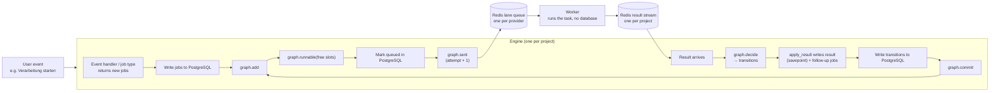
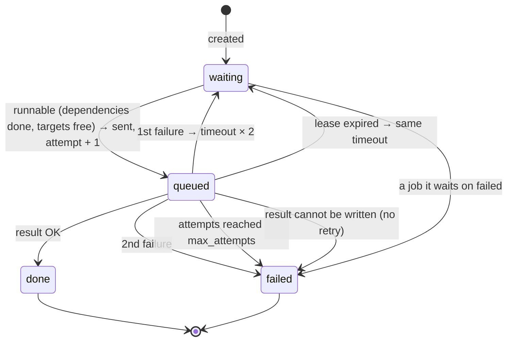
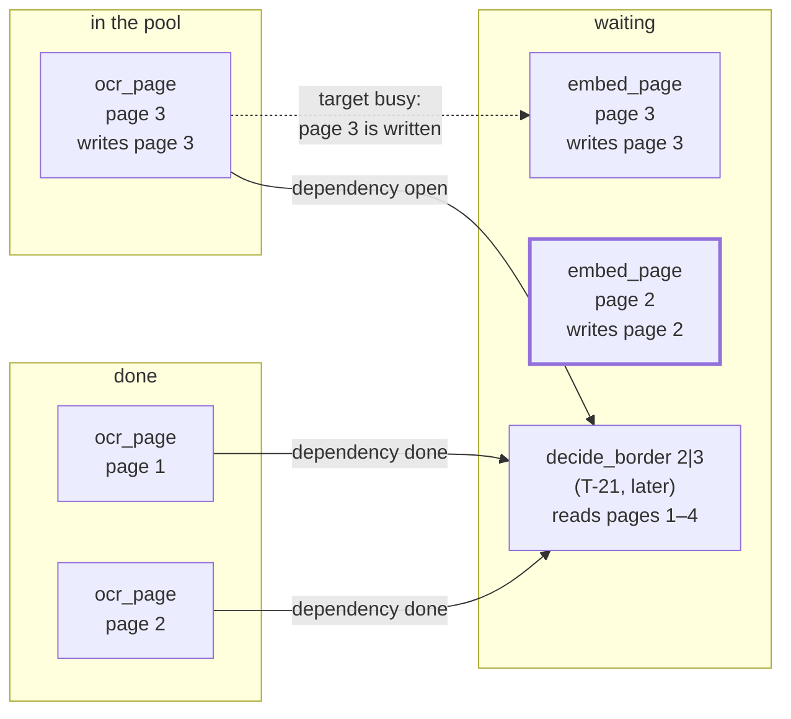
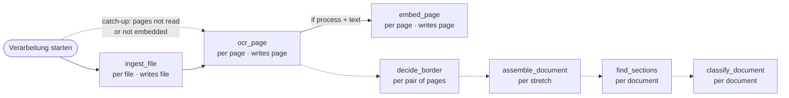
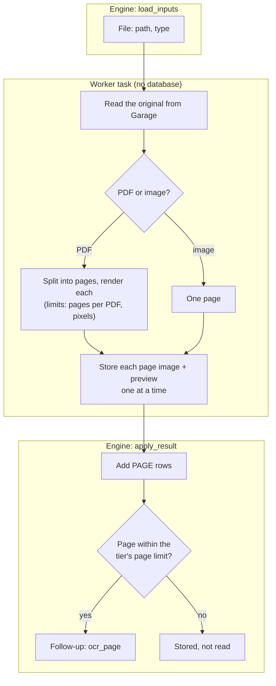
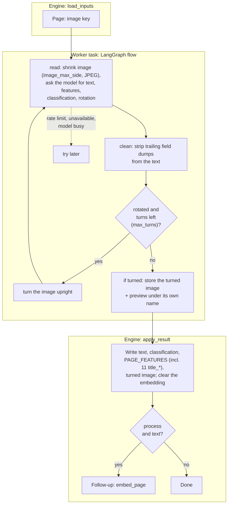
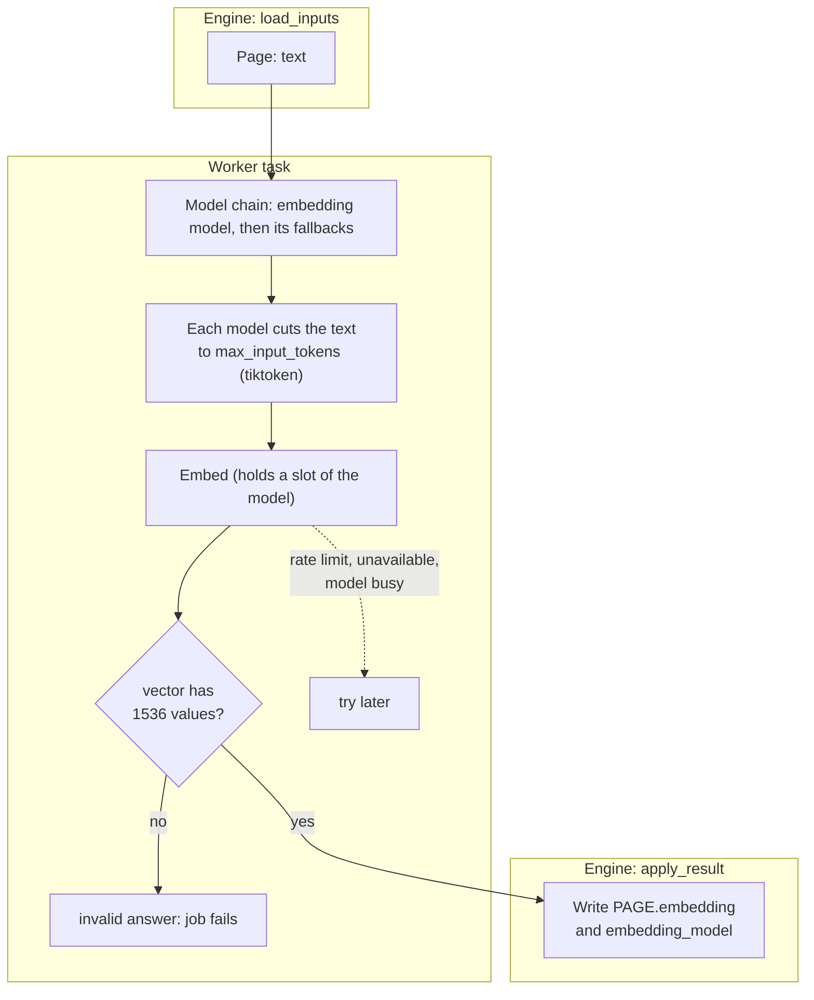

# paragraph82b — Job Graph

Status: current, describes the job pool after T-35 (submodule `1c32b2b`) · 2026-11-26

How the scheduling core of the processing runtime links jobs. Code: `backend/app/modules/processing/engine/graph.py`. The same diagrams as a page: `Job_Graph.html`, published as an artifact:
https://claude.ai/artifact/6xjiJ2m2AQugA58F12gza8. Runtime in general: [`Architecture.md`](Architecture.md), section 5;
tables `JOB`, `JOB_TARGET`, `JOB_DEPENDENCY`: [`Data_Model.md`](Data_Model.md).

## 1. Where the graph sits

The graph is pure logic: no database, no Redis. The engine (one per project) is the shell around it. It writes a
decision to PostgreSQL first and only then tells the graph, so the graph only ever holds committed state.

## 2. What one job goes through

Status in the database: `waiting`, `queued`, `done`, `failed`; "running" exists only in Redis. Done and failed jobs
leave the graph and stay in the database. New in T-35: the attempt cap (`max_attempts` in the configuration), a
result that cannot be written fails one job instead of stopping the project, and a job waiting on a failed job fails
too instead of waiting forever.

## 3. How jobs block each other

- **Dependencies** (`JOB_DEPENDENCY`): "B may only start after A is done". Not used by any job type yet;
  `decide_border` (T-21) will be the first, waiting for the reading of every page in its window.
- **Targets** (`JOB_TARGET`): a job reads or writes objects (a file, a page). It only starts if none of its write
  targets is in use and none of its read targets is being written.
- Among runnable jobs: lower priority first (0 = "Apply changes", 1 = normal), then creation order.

Example: only `embed_page` of page 2 can start (thick border); `embed_page` of page 3 waits for its target, the
border waits for the reading of page 3.

## 4. Job types and how they follow each other

Today the chain runs through follow-ups: when a job's result is written, its job type returns the next jobs. Dashed:
planned in the slices T-21 to T-24.

## 5. Inside each job type

Every job type has two halves: the **engine part** (`load_inputs` reads what the task needs from PostgreSQL,
`apply_result` writes the result and returns the follow-up jobs) and the **worker part** (the task: no database,
reads and writes files in Garage, calls models). Rate limits, unavailable or busy models put a job back to be tried
later (`TryLater`), which the graph treats like an expired lease.

### ingest_file

### ocr_page

The worker part is a LangGraph flow: read, clean, turn and read again while the page is rotated (at most `max_turns`).

### embed_page

## Graph operations

| Operation | What it does |
|---|---|
| `add` | Adopts new or loaded jobs with their open dependencies and targets |
| `runnable(limit)` | Waiting jobs with all dependencies done and targets free, by priority then age, at most the free slots |
| `sent` | Marks jobs as in the pool under a new attempt |
| `decide` | Turns a result (done, failed, lease expired) into transitions; ignores older attempts |
| `fail` | Lasting failure without retry, e.g. a result that cannot be written |
| `commit` | Applies transitions after the database is written; done jobs free their dependents |
| `drop` | Forgets deleted jobs (stage reset) |
| `is_idle` | Nothing in the pool and nothing that could run: the engine may be unloaded |
