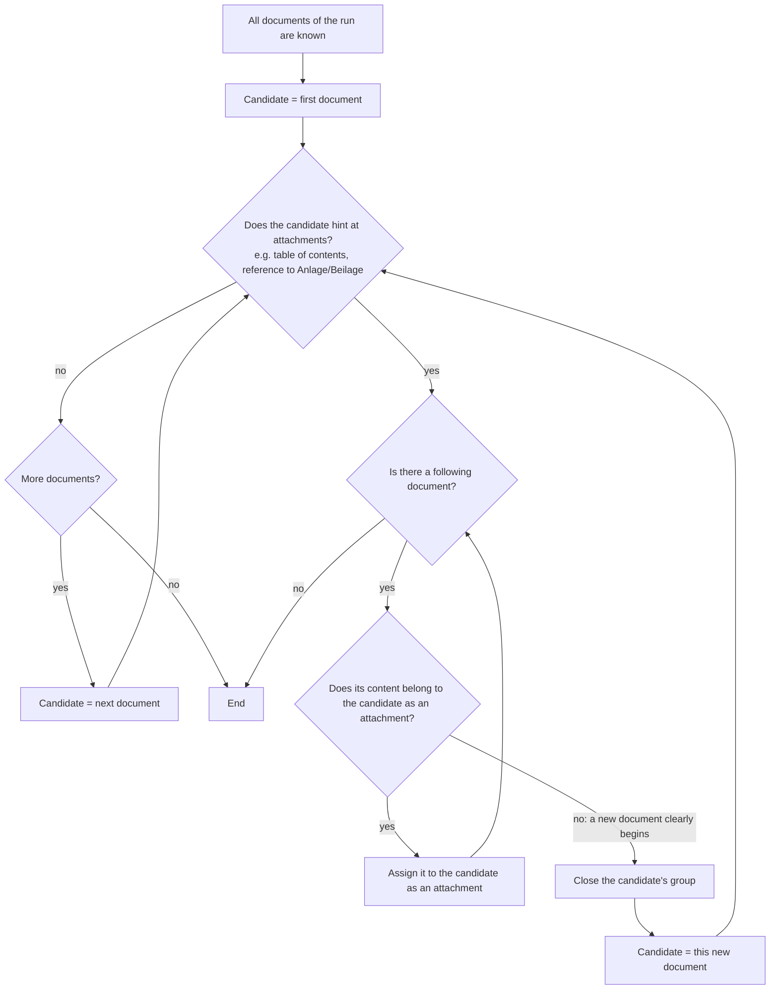

# I-1: Detect attachments when grouping files into documents

- **Status:** open
- **Raised by:** Andreas, 2026-11-09
- **Moved:** from the prototype project (ai-workspace, `paragraph-82b-prototype`) on 2026-11-25, as input for
  `link_attachments` (T-18, `docs/Grouping_and_Classification.md`, section "Attachments")
- **Related (prototype project, historical):** pipeline step 3 "Clustering of files into documents",
  `document_creation`; prototype T-6 (ADR-paragraph-82b-prototype-0002, one PDF = one document), prototype T-7 (new
  files form new documents among themselves)

## Idea
When grouping, detect whether a following document is an attachment of its predecessor or a document of its own.
The grouping logic will be reworked in a later refactor; this idea is meant as input for it.

## Current state
According to Andreas, attachments are not considered at all: every attachment is handled as a new document.
Not yet verified in the code.

## Sketch
Runs after all documents of the run are known, in their order.

Confirmed by Andreas (2026-11-09): when the attachment chain ends, the document that ended it becomes the next
candidate and is itself checked for attachment hints; the run does not stop.

## Open questions
- Which hints count as attachment indicators (table of contents, "Anlage", "Beilage", enclosure lists, …)?
- How is "belongs to the candidate in content" decided — rules, LLM, or both? What makes a new document "clearly" begin?
- Can an attachment appear without any hint in the main document, and should that case be covered?
- How are attachments represented: part of the main document, or own documents linked to it? Effect on document
  determination (step 4) and Key Info extraction (step 5)?
- How does it fit the later grouping refactor, a multi-page PDF (one PDF = one document, T-6), and incremental runs
  where new files are grouped only among themselves (T-7)?

## Notes
- 2026-11-25 (T-18 grilling, Andreas): attachments are documents of their own, linked by
  `DOCUMENT.attached_to_document_id`; `keep` documents are attached simply in `assemble_document`; this idea becomes
  the later job type `link_attachments` after `classify_document`. A duplicate attachment keeps its link and points
  to its original. Answers the open question "part of the main document, or own documents linked to it?". PDFs are
  now split into pages (no longer one PDF = one document), and grouping runs per batch of "Verarbeitung starten".

## Grilling
